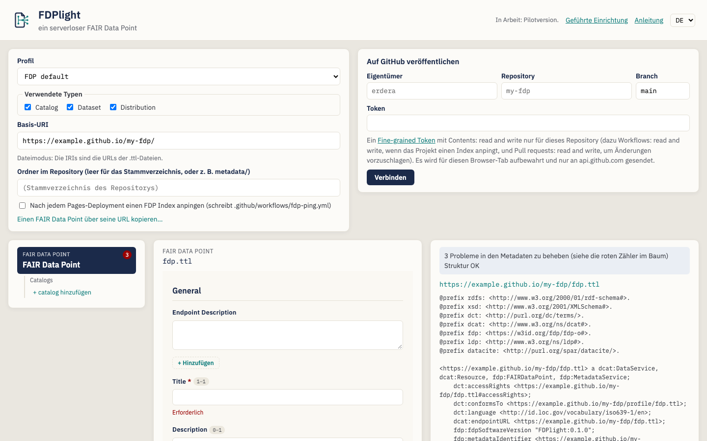
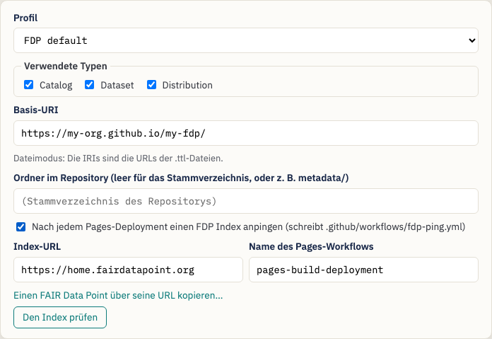
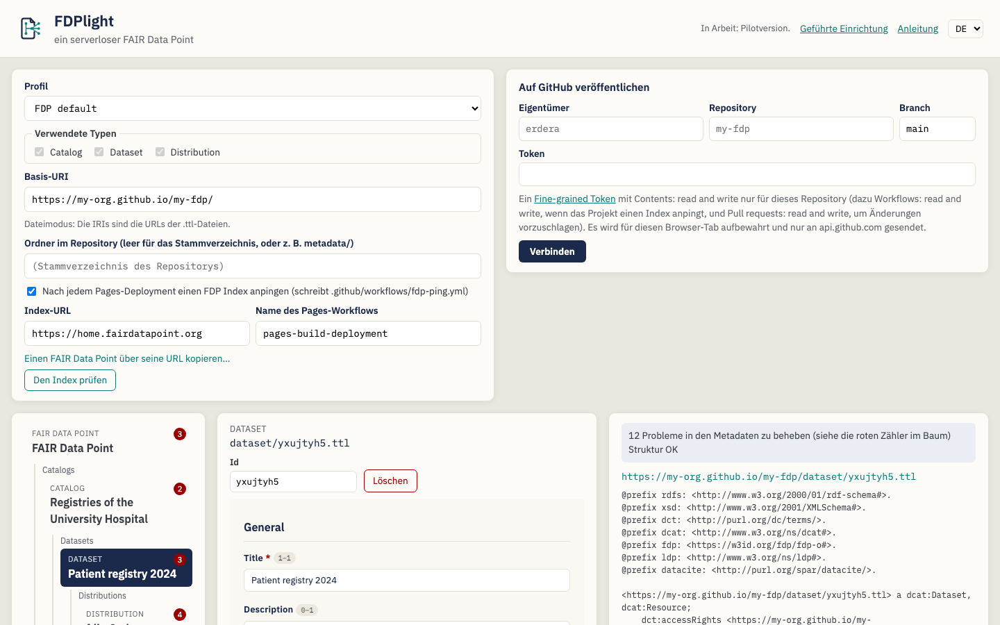
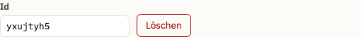
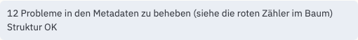
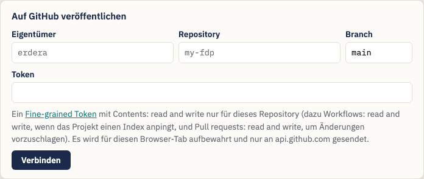
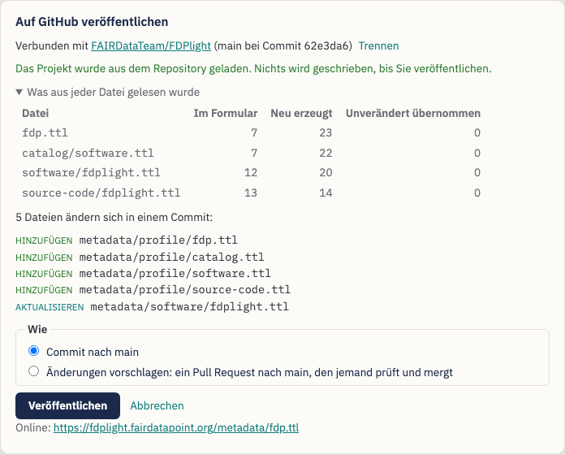
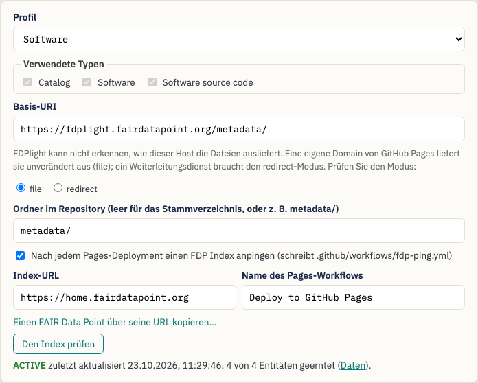
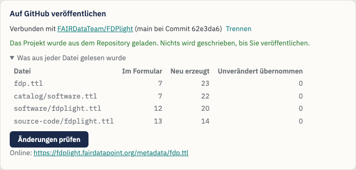

# Einen FAIR Data Point mit FDPlight veröffentlichen — Eine Anleitung für Data Stewards

> **Hinweis:** Dies ist eine Übersetzung, die noch nicht von einer
> muttersprachlichen Person geprüft wurde. Maßgeblich ist die englische
> Anleitung: [English](data-steward-guide.md).

**FDPlight** veröffentlicht einen [FAIR Data Point](https://www.fairdatapoint.org/)
(FDP) ohne Server. Sie beschreiben Ihre Kataloge, Datensätze und
Distributionen in Formularen; FDPlight schreibt für jede Beschreibung eine
Turtle-Datei, verknüpft sie so, wie es ein FDP tut, und committet sie in ein
GitHub-Repository. GitHub Pages liefert die Dateien aus, und ein FDP Index
kann sie finden und ernten.

> *Der Slogan von FDPlight: **ein serverloser FAIR Data Point.***

Diese Anleitung richtet sich an **Data Stewards**, die die Metadaten ihrer
Organisation über FAIR Data Point Indexes auffindbar machen möchten, ohne
einen FDP-Server zu betreiben oder zu pflegen.

> **Keine Installation.** FDPlight ist eine Webseite:
> <https://fdplight.fairdatapoint.org/>. Alles geschieht in Ihrem Browser;
> der einzige Dienst, mit dem es während der Bearbeitung kommuniziert, ist
> GitHub.

---

## Inhalt

1. [Grundbegriffe](#1-grundbegriffe)
2. [Bevor Sie beginnen](#2-bevor-sie-beginnen)
3. [Tutorial: Ihren ersten FAIR Data Point veröffentlichen](#3-tutorial-ihren-ersten-fair-data-point-veröffentlichen)
   - [Schritt 1 — Projekteinstellungen](#schritt-1--projekteinstellungen)
   - [Schritt 2 — Den FAIR Data Point selbst beschreiben](#schritt-2--den-fair-data-point-selbst-beschreiben)
   - [Schritt 3 — Kataloge, Datensätze und Distributionen hinzufügen](#schritt-3--kataloge-datensätze-und-distributionen-hinzufügen)
   - [Schritt 4 — Beheben, was die Prüfungen melden](#schritt-4--beheben-was-die-prüfungen-melden)
   - [Schritt 5 — Mit GitHub verbinden](#schritt-5--mit-github-verbinden)
   - [Schritt 6 — Prüfen und veröffentlichen](#schritt-6--prüfen-und-veröffentlichen)
   - [Schritt 7 — Den Index prüfen](#schritt-7--den-index-prüfen)
4. [Später bearbeiten](#4-später-bearbeiten)
5. [Einen bestehenden FAIR Data Point importieren](#5-einen-bestehenden-fair-data-point-importieren)
6. [Profile: welche Formulare Sie erhalten](#6-profile-welche-formulare-sie-erhalten)
7. [Tipps und Fehlerbehebung](#7-tipps-und-fehlerbehebung)

---

## 1. Grundbegriffe

| Begriff | Was er in FDPlight bedeutet |
|---|---|
| **FAIR Data Point (FDP)** | Ein Baum von Metadateneinträgen: der FDP selbst an der Wurzel, darunter Kataloge, Datensätze, Distributionen (oder andere Typen, die Ihr Profil festlegt). |
| **Entität** | Ein Eintrag in diesem Baum. Jede Entität ist **eine Turtle-Datei** in Ihrem Repository, z. B. `catalog/rare-diseases.ttl`. |
| **Basis-URI** | Wo Ihre Dateien ausgeliefert werden, z. B. `https://my-org.github.io/my-fdp/`. Die IRI jeder Entität beginnt damit. |
| **IRI** | Der Identifikator einer Entität. Im üblichen *Dateimodus* ist sie einfach die URL ihrer Datei, z. B. `https://my-org.github.io/my-fdp/catalog/rare-diseases.ttl`. |
| **Profil** | Die Menge der Entitätstypen und ihrer Formulare (SHACL-Shapes). Standard ist das Profil des FAIR Data Point selbst; Sie können auch das Profil eines laufenden FDP importieren oder eines aus Dateien öffnen. |
| **Verknüpfung** | Die Verbindungen, die ein FDP zwischen den Einträgen braucht: Links zu Eltern- und Kindeinträgen, LDP-Container, Identifikatoren, Zeitstempel. FDPlight **schreibt all das für Sie**; Sie füllen nur die Formulare aus. |
| **FDP Index** | Ein Dienst wie [home.fairdatapoint.org](https://home.fairdatapoint.org/), der FDPs auflistet und ihre Metadaten erntet. FDPlight kann einen automatischen *Ping* einrichten, damit Ihr FDP gelistet bleibt. |

## 2. Bevor Sie beginnen

Sie brauchen:

- **Ein GitHub-Repository** für die Metadaten, zum Beispiel `my-org/my-fdp`.
  Es kann ein neues, leeres Repository sein oder eines, das bereits andere
  Inhalte hat: Legen Sie den FDP dann in einen Ordner wie `metadata/`.
- **Aktiviertes GitHub Pages** für dieses Repository (*Settings → Pages*).
  Die übliche Wahl ist *Deploy from a branch*, Branch `main`, Ordner `/`.
  Ihre Basis-URI ist dann `https://{owner}.github.io/{repository}/`, plus
  den Ordner, falls Sie einen verwenden. Hat die Pages-Website eine eigene
  Domain (zum Beispiel `https://fdp.example.org/`), verwenden Sie stattdessen
  diese Domain und wählen *file*, wenn FDPlight fragt, wie der Host die
  Dateien ausliefert.
- **Ein Fine-grained Personal Access Token** nur für dieses Repository
  ([eines erstellen](https://github.com/settings/personal-access-tokens/new)):
  - *Contents: read and write* — immer;
  - *Workflows: read and write* — wenn FDPlight einen FDP Index anpingen soll;
  - *Pull requests: read and write* — wenn Sie Änderungen zur Prüfung
    vorschlagen möchten, statt direkt zu veröffentlichen.

  Gehört das Repository einer Organisation, muss die Organisation
  Fine-grained Tokens eventuell erst zulassen, und eine verantwortliche
  Person (Owner) muss Ihr Token möglicherweise genehmigen.

FDPlight bewahrt das Token nur im aktuellen Browser-Tab auf und sendet es
nur an `api.github.com`. Wenn Sie den Tab schließen, ist es vergessen.

## 3. Tutorial: Ihren ersten FAIR Data Point veröffentlichen

Wenn Sie FDPlight öffnen, sehen Sie oben die Projekteinstellungen und den
Bereich zum Veröffentlichen, darunter den **Entitätenbaum** (links), das
**Formular** der ausgewählten Entität (Mitte) sowie die **Prüfungen und die
erzeugte Datei** (rechts).

**Geführte Einrichtung (optional).** Beim ersten Besuch bietet FDPlight eine
geführte Einrichtung an. Sie fragt nach dem Repository (Eigentümer, Name,
Branch, Ordner), zeigt die daraus folgende Basis-URI, lässt Sie ein Profil
wählen und entscheiden, ob ein FDP Index angepingt werden soll, und füllt die
Einstellungen und das Verbindungsformular aus, wenn Sie auf *Fertigstellen*
klicken. *Überspringen* lässt alles, wie es war. Sie können sie jederzeit
über *Geführte Einrichtung* in der Kopfzeile erneut öffnen oder die Schritte
1 bis 7 unten von Hand durchgehen.

### Schritt 1 — Projekteinstellungen

- **Profil** — behalten Sie *FDP default*, es sei denn, Ihre Community
  verwendet ein anderes (siehe [Abschnitt 6](#6-profile-welche-formulare-sie-erhalten)).
- **Basis-URI** — wo GitHub Pages Ihre Dateien ausliefert. Sobald Sie mit
  GitHub verbunden sind, schlägt FDPlight `https://{owner}.github.io/{repository}/`
  vor. Sie muss mit `https://` beginnen und mit `/` enden. FDPlight zeigt,
  welchen *IRI-Modus* es verwendet: Für `github.io`-Adressen ist das der
  *Dateimodus*, in dem jede IRI die URL ihrer `.ttl`-Datei ist.
- **Ordner im Repository** — lassen Sie das Feld leer, um im
  Stammverzeichnis des Repositorys zu veröffentlichen, oder geben Sie einen
  Ordner wie `metadata/` ein. Die Basis-URI muss ihn dann enthalten.
- **Nach jedem Pages-Deployment einen FDP Index anpingen** — kreuzen Sie
  dies an, damit FDPlight eine kleine GitHub Action
  (`.github/workflows/fdp-ping.yml`) hinzufügt, die den Index nach jedem
  Pages-Deployment und alle drei Tage über Ihren FDP informiert, sodass er
  *active* bleibt. Der *Name des Pages-Workflows* ist
  `pages-build-deployment`, wenn Pages aus einem Branch bereitstellt; hat Ihr
  Repository einen eigenen Deploy-Workflow, geben Sie dessen Namen ein.

### Schritt 2 — Den FAIR Data Point selbst beschreiben

Die Wurzel des Baums, *FAIR Data Point*, ist ausgewählt. Füllen Sie ihr
Formular aus: einen Titel, einen Herausgeber, eine Version und alles Weitere,
was Ihr Profil verlangt. Mit einem roten Sternchen markierte Felder sind
Pflichtfelder.

### Schritt 3 — Kataloge, Datensätze und Distributionen hinzufügen

Verwenden Sie die Links **+ … hinzufügen** im Baum. Jede neue Entität wird
sofort ausgewählt, damit Sie ihr Formular ausfüllen können; der Baum zeigt
ihren Titel, sobald sie einen hat.

Unter dem Entitätstyp und ihrem Dateinamen finden Sie:

- **Id** — der letzte Teil des Dateinamens und der IRI. FDPlight denkt sich
  eine zufällige aus; Sie können sie durch etwas Lesbares ersetzen, etwa
  `patient-registry-2024`, **solange die Entität noch nicht veröffentlicht
  ist**. Danach ist die Id Teil einer öffentlichen IRI und gesperrt.
- **Verschieben nach** — erscheint, wenn es einen anderen Ort gibt, an den
  die Entität passt, zum Beispiel einen zweiten Katalog. Beim Verschieben
  behält die Entität ihre Datei und ihre IRI; es ist deshalb auch nach dem
  Veröffentlichen erlaubt.
- **Löschen** — entfernt die Entität und alles darunter.

Sie können sich mit der Tastatur durch den Baum bewegen: **↑ ↓** zur
vorherigen oder nächsten Entität, **← →** zum Elterneintrag oder zum ersten
Kindeintrag, **Pos1** (Home) und **Ende** (End) zum ersten und letzten.

### Schritt 4 — Beheben, was die Prüfungen melden

FDPlight prüft jede Entität während der Eingabe gegen ihr Profil.

- Die **roten Zahlen im Baum** zählen die Probleme pro Entität.
- Im Formular erscheint jedes Problem unter seinem Feld (zum Beispiel
  *Erforderlich*).
- Der Kasten oben rechts fasst zusammen: *N Probleme in den Metadaten zu
  beheben*, und ob die **Struktur** in Ordnung ist (Links, IRIs, der Typ der
  Wurzel).

Unter den Prüfungen sehen Sie die **genaue Turtle-Datei**, die FDPlight für
die ausgewählte Entität veröffentlichen wird, einschließlich der gesamten
Verknüpfung, die es hinzufügt.

Solange es Probleme gibt, können Sie nicht veröffentlichen: Der Bereich zum
Veröffentlichen sagt Ihnen, was Sie zuerst beheben müssen.

### Schritt 5 — Mit GitHub verbinden

Geben Sie den Eigentümer, das Repository, den Branch (meist `main`) und Ihr
Token ein und klicken Sie dann auf **Verbinden**.

- Hat das Repository bereits ein FDPlight-Projekt, **lädt** FDPlight es:
  Einstellungen, Profil, Baum und Metadaten kommen aus den Dateien. Hatten
  Sie bereits etwas eingegeben, fragt es nach, bevor es dies ersetzt.
- Hat das Repository noch keinen FDP, ändert sich nichts, und die Basis-URI
  wird aus dem Namen des Repositorys vorgeschlagen.

### Schritt 6 — Prüfen und veröffentlichen

Klicken Sie auf **Änderungen prüfen**. FDPlight listet die Dateien auf, die
es hinzufügen, aktualisieren oder entfernen wird, und lässt Sie dann wählen,
**wie**:

- **Commit nach `main`** — die Änderungen gehen mit dem nächsten
  Pages-Deployment online, meist innerhalb von ein bis zwei Minuten.
- **Änderungen vorschlagen** — FDPlight legt denselben Commit auf einen
  neuen Branch und öffnet einen **Pull Request**, damit eine Kollegin oder
  ein Kollege ihn zuerst auf GitHub prüfen kann. Mit dem Merge des Pull
  Requests werden die Änderungen veröffentlicht.

Nach dem Veröffentlichen ruft **Prüfen, ob es online ist** Ihren FDP von der
Basis-URI ab. Wird er noch nicht ausgeliefert, zeigt FDPlight, wie Sie
GitHub Pages einschalten; die erste Bereitstellung dauert ein bis zwei
Minuten. Wenn Sie sich mit einem Repository verbinden, das bereits einen FDP
enthält, führt FDPlight diese Prüfung von selbst aus.

Alles wird in **einem Commit** geschrieben. FDPlight aktualisiert eine Datei
nur, wenn sich ihr Inhalt ändert; das *Änderungsdatum* (modified) eines
Eintrags ändert sich also nur, wenn sich der Eintrag selbst (oder die Liste
seiner Kindeinträge) geändert hat. Hat seit Ihrer Verbindung jemand anderes
in den Branch veröffentlicht, wird nichts geschrieben: Verbinden Sie sich
neu, um diese Änderungen zu laden, und wenden Sie dann Ihre erneut an.

### Schritt 7 — Den Index prüfen

Pingt das Projekt einen Index an, erscheint in den Einstellungen die
Schaltfläche **Den Index prüfen**. Sie zeigt, ob der Index Ihren FDP kennt,
seinen Status, wann er ihn zuletzt geerntet hat und wie viele Ihrer
Entitäten er enthält.

Der erste Ping erfolgt nach dem ersten Pages-Deployment, das auf Ihre
Veröffentlichung folgt; das Ernten dauert noch einige Sekunden. Ein FDP, der
eine Woche lang nicht angepingt wird, wird im Index *inactive*; der
Ping-Workflow verhindert das.

## 4. Später bearbeiten

Öffnen Sie FDPlight, verbinden Sie sich mit demselben Repository, und das
Projekt wird aus den Dateien geladen. FDPlight zeigt, was es aus jeder Datei
gelesen hat:

- **Im Formular** — Werte, die Sie bearbeiten können;
- **Neu erzeugt** — die Verknüpfung, die FDPlight bei jeder Veröffentlichung
  neu schreibt;
- **Unverändert übernommen** — alles, wofür das Formular kein Feld hat.
  FDPlight verwirft es nie: Es wird unverändert zurückgeschrieben.

Bearbeiten Sie, klicken Sie dann auf **Änderungen prüfen** und
veröffentlichen Sie wie zuvor. Erneutes Veröffentlichen ohne Änderungen
ändert nichts.

## 5. Einen bestehenden FAIR Data Point importieren

FDPlight kann einen dateibasierten FDP übernehmen, den es nicht selbst
erstellt hat, zum Beispiel einen von Hand geschriebenen. Verbinden Sie sich
mit seinem Repository; gibt es dort kein FDPlight-Projekt, bietet der
Bereich an, einen FDP zu **importieren**. Geben Sie den Pfad der
Stammdatei an (der Datei, die den FDP selbst beschreibt) und wählen Sie:

- **Die bestehenden IRIs behalten** (empfohlen) — jeder Eintrag behält seine
  Datei und seine IRI, sodass Identifikatoren und der Index-Eintrag gültig
  bleiben. Neue Entitäten folgen dem Layout von FDPlight.
- **Zum Layout von FDPlight wechseln** — die Einträge wandern in Dateien wie
  `catalog/{id}.ttl`, und alle IRIs ändern sich. Die alten Dateien bleiben im
  Repository, bis Sie sie löschen.

Der Importbericht listet alles auf, was FDPlight korrigieren musste oder
nicht lesen konnte, zum Beispiel einen Container, den sich zwei Dateien
teilen, oder einen Identifikator, der nicht zu seinem Eintrag passt. Die
erste Veröffentlichung korrigiert die Verknüpfung; alle Metadaten bleiben
erhalten.

### Einen FAIR Data Point über seine Adresse kopieren

Läuft der FDP woanders (ein FAIR-Data-Point-Server, eine w3id-Adresse, eine
Website), verwenden Sie **Einen FAIR Data Point über seine URL kopieren…** in
den Projekteinstellungen. Legen Sie zuerst die Basis-URI fest: Jeder Eintrag
erhält darunter eine neue IRI und behält einen Verweis auf seine alte IRI
(`prov:wasDerivedFrom`). Das Original wird nicht verändert. FDPlight lässt
weg, was der alte Server über sich selbst erzeugt hat (seine Metriken,
Profile und API-Beschreibung), und schreibt eigene. Prüfen Sie anschließend
die Formulare: Den Einträgen fehlen oft Felder, die Ihr Profil verlangt.

## 6. Profile: welche Formulare Sie erhalten

Die Einstellung **Profil** legt fest, welche Entitätstypen es gibt, wie sie
verschachtelt sind und welche Felder ihre Formulare haben.

- **FDP default** — das Profil des FAIR Data Point selbst: FAIR Data Point →
  Kataloge → Datensätze → Distributionen.
- **Software** — FAIR Data Point → Kataloge → Software → Quellcode.
- **ERDERA** — das Profil der ERDERA / EJP RD Virtual Platform: FAIR Data
  Point → Kataloge → Datensätze → Distributionen → Zugriffsdienste, und
  unter einem Katalog außerdem Patientenregister, Biobanken, Leitlinien und
  Datendienste. Jeder Eintrag gibt an, dass er für die Virtual Platform
  sichtbar ist (`ejp:vpConnection ejp:VPDiscoverable`), es sei denn, Sie
  entscheiden sich, ihn zu verbergen. Jeder Datendienst braucht seinen
  *Ontological Type*: Die Virtual Platform listet Datendienste nur, wenn sie
  einen haben. Verbergen Sie Einträge mit Bedacht: Mit den aktuellen
  Abfragen der Virtual Platform kann ein verborgener Eintrag auch andere
  Einträge verbergen, und FDPlight zeigt bei einem verborgenen Eintrag eine
  Warnung an.

- **Aus einem FAIR Data Point importieren…** — geben Sie die Adresse eines
  laufenden FDP ein (zum Beispiel `https://home.fairdatapoint.org`); FDPlight
  übernimmt seine Entitätstypen und deren Shapes, sodass Ihre Dateien
  demselben Profil folgen.
- **Aus Dateien öffnen…** — wählen Sie ein Profil, das auf Ihrem Computer
  gespeichert ist: eine JSON-Datei mit den Typen (die `fdplight.json` eines
  anderen Projekts genügt) und die Turtle-Shape-Dateien, die sie nennt.
  FDPlight listet jede Datei auf, die fehlt oder fehlerhaft ist.

**Verwendete Typen.** Hat ein Profil optionale Typen, kreuzen Sie unter
*Verwendete Typen* diejenigen an, die Sie brauchen; die anderen werden im
Baum nicht angeboten. Ein Typ, der bereits Einträge hat, bleibt angekreuzt,
bis Sie diese löschen.

Ein Profilwechsel beginnt ein neues, leeres Projekt. Das Profil wird mit
Ihren Dateien im Repository gespeichert, sodass alle, die sich später
verbinden, dieselben Formulare erhalten.

## 7. Tipps und Fehlerbehebung

| Meldung oder Symptom | Was zu tun ist |
|---|---|
| *GitHub hat das Token abgelehnt (401).* | Das Token ist falsch oder abgelaufen. Erstellen Sie ein neues. |
| *Repository oder Branch nicht gefunden, oder das Token hat keinen Zugriff darauf (404).* | Prüfen Sie die Schreibweise und ob das Token für dieses Repository erstellt (und bei einer Organisation genehmigt) wurde. |
| *The branch has new commits …* | Inzwischen hat jemand anderes veröffentlicht. Verbinden Sie sich neu und nehmen Sie Ihre Änderungen dann erneut vor. |
| Die Veröffentlichung scheitert an `.github/workflows/fdp-ping.yml` | Dem Token fehlt *Workflows: read and write*. |
| *… ist noch nicht im Web.* | Schalten Sie GitHub Pages ein (*Settings → Pages → Deploy from a branch*), sehen Sie im Tab *Actions* nach dem Pages-Deployment und klicken Sie dann auf *Erneut prüfen*. |
| Der Index listet den FDP nicht | Warten Sie auf das Pages-Deployment und den Workflow *Ping FDP Index* im Tab *Actions*; Sie können diesen Workflow dort auch von Hand starten. |
| Die Oberfläche hat die falsche Sprache | Verwenden Sie das Sprachmenü (*Sprache*) oben rechts. |
