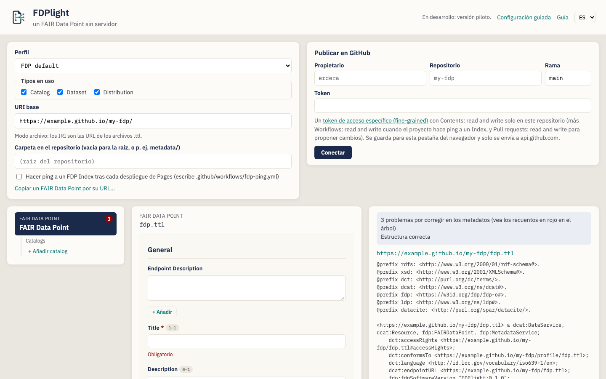
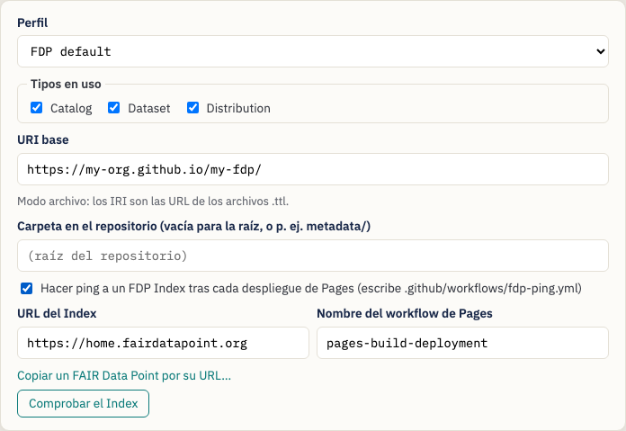
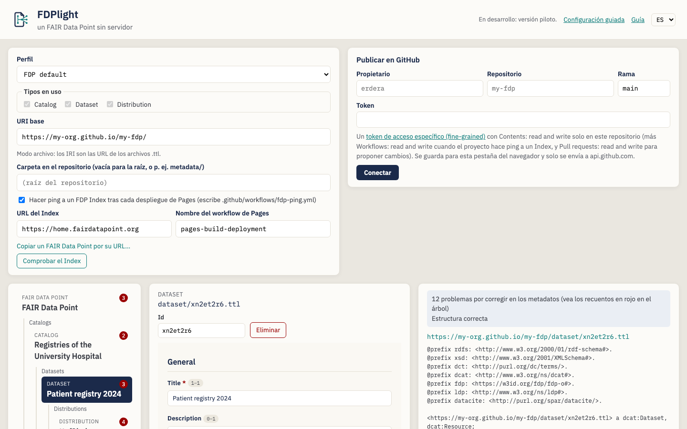
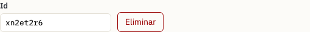
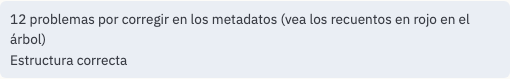
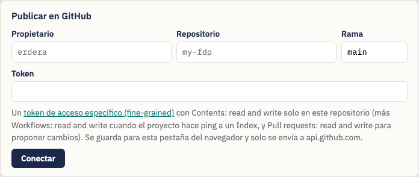
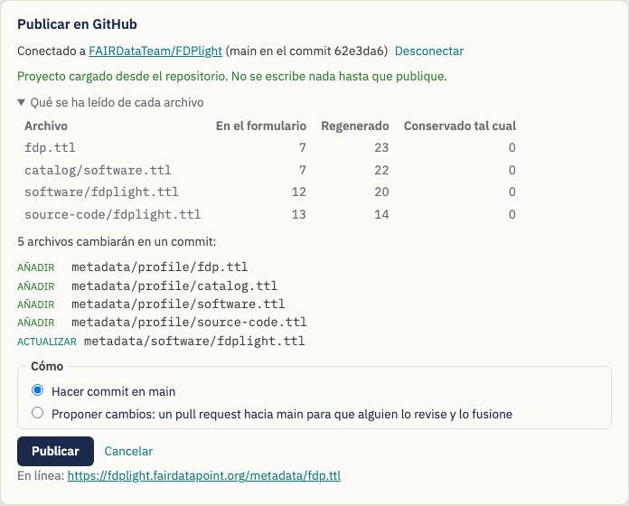
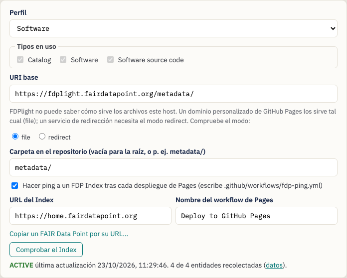
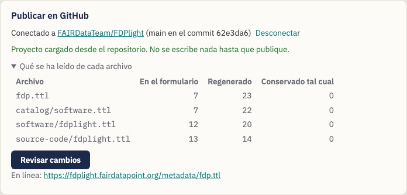

# Publicar un FAIR Data Point con FDPlight — Guía para data stewards

> Esta es una traducción que todavía no ha revisado un hablante nativo. La
> guía en inglés es la versión de referencia: [English](data-steward-guide.md).

**FDPlight** publica un [FAIR Data Point](https://www.fairdatapoint.org/)
(FDP) sin servidor. Usted describe sus catálogos, conjuntos de datos y
distribuciones en formularios; FDPlight escribe un archivo Turtle por cada
descripción, los enlaza entre sí como lo hace un FDP y los guarda con un
commit en un repositorio de GitHub. GitHub Pages sirve los archivos, y un
FDP Index puede encontrarlos y recolectarlos.

> *El lema de FDPlight: **un FAIR Data Point sin servidor.***

Esta guía está pensada para **data stewards** que quieren que los metadatos
de su organización se puedan encontrar a través de los FAIR Data Point
Indexes, sin tener que ejecutar ni mantener un servidor FDP.

> **Sin instalación.** FDPlight es una página web:
> <https://fdplight.fairdatapoint.org/>. Todo ocurre en su navegador; el
> único servicio con el que se comunica mientras usted edita es GitHub.

---

## Índice

1. [Conceptos clave](#1-conceptos-clave)
2. [Antes de empezar](#2-antes-de-empezar)
3. [Tutorial: publique su primer FAIR Data Point](#3-tutorial-publique-su-primer-fair-data-point)
   - [Paso 1 — Ajustes del proyecto](#paso-1--ajustes-del-proyecto)
   - [Paso 2 — Describa el propio FAIR Data Point](#paso-2--describa-el-propio-fair-data-point)
   - [Paso 3 — Añada catálogos, conjuntos de datos y distribuciones](#paso-3--añada-catálogos-conjuntos-de-datos-y-distribuciones)
   - [Paso 4 — Corrija lo que indican las comprobaciones](#paso-4--corrija-lo-que-indican-las-comprobaciones)
   - [Paso 5 — Conéctese a GitHub](#paso-5--conéctese-a-github)
   - [Paso 6 — Revise y publique](#paso-6--revise-y-publique)
   - [Paso 7 — Compruebe el Index](#paso-7--compruebe-el-index)
4. [Editar más adelante](#4-editar-más-adelante)
5. [Importar un FAIR Data Point existente](#5-importar-un-fair-data-point-existente)
6. [Perfiles: qué formularios obtiene](#6-perfiles-qué-formularios-obtiene)
7. [Consejos y solución de problemas](#7-consejos-y-solución-de-problemas)

---

## 1. Conceptos clave

| Término | Qué significa en FDPlight |
|---|---|
| **FAIR Data Point (FDP)** | Un árbol de registros de metadatos: el propio FDP en la raíz y, debajo, catálogos, conjuntos de datos y distribuciones (u otros tipos que defina su perfil). |
| **Entidad** | Un registro de ese árbol. Cada entidad es **un archivo Turtle** de su repositorio, p. ej. `catalog/rare-diseases.ttl`. |
| **URI base** | Dónde se sirven sus archivos, p. ej. `https://my-org.github.io/my-fdp/`. El IRI de cada entidad empieza por él. |
| **IRI** | El identificador de una entidad. En el habitual *modo archivo* es simplemente la URL de su archivo, p. ej. `https://my-org.github.io/my-fdp/catalog/rare-diseases.ttl`. |
| **Perfil** | El conjunto de tipos de entidad y sus formularios (formas SHACL). El predeterminado es el perfil propio del FAIR Data Point; también puede importar el perfil de un FDP en funcionamiento, o abrir uno desde archivos. |
| **Cableado** | Los enlaces que un FDP necesita entre sus registros: enlaces entre padres e hijos, contenedores LDP, identificadores y marcas de tiempo. FDPlight **lo escribe todo por usted**; usted solo rellena los formularios. |
| **FDP Index** | Un servicio, como [home.fairdatapoint.org](https://home.fairdatapoint.org/), que lista FDPs y recolecta sus metadatos. FDPlight puede configurar un *ping* automático que mantiene su FDP en la lista. |

## 2. Antes de empezar

Necesita:

- **Un repositorio de GitHub** para los metadatos, por ejemplo
  `my-org/my-fdp`. Puede ser un repositorio nuevo y vacío o uno que ya tenga
  otro contenido: en ese caso, ponga el FDP en una carpeta como `metadata/`.
- **GitHub Pages activado** en ese repositorio (*Settings → Pages*). Lo
  habitual es elegir *Deploy from a branch*, rama `main`, carpeta `/`. Su
  URI base será entonces `https://{owner}.github.io/{repository}/`, más la
  carpeta si usa una. Si el sitio de Pages tiene un dominio personalizado
  (por ejemplo `https://fdp.example.org/`), use ese dominio en su lugar y
  elija *file* cuando FDPlight le pregunte cómo sirve los archivos el host.
- **Un token de acceso personal específico (fine-grained)** solo para ese
  repositorio ([cree uno](https://github.com/settings/personal-access-tokens/new)):
  - *Contents: read and write* — siempre;
  - *Workflows: read and write* — si FDPlight debe hacer ping a un FDP Index;
  - *Pull requests: read and write* — si quiere proponer cambios para que
    se revisen en lugar de publicar directamente.

  Si el repositorio pertenece a una organización, puede que la organización
  tenga que permitir antes los tokens fine-grained, y que un propietario
  tenga que aprobar el suyo.

FDPlight guarda el token solo en la pestaña actual del navegador y solo lo
envía a `api.github.com`. Al cerrar la pestaña, el token se olvida.

## 3. Tutorial: publique su primer FAIR Data Point

Al abrir FDPlight verá arriba los ajustes del proyecto y el panel de
publicación y, debajo, el **árbol de entidades** (a la izquierda), el
**formulario** de la entidad seleccionada (en el centro) y las
**comprobaciones y el archivo generado** (a la derecha).

**Configuración guiada (opcional).** En su primera visita, FDPlight le
ofrece una configuración guiada. Le pide el repositorio (propietario,
nombre, rama, carpeta), le muestra el URI base que resulta de él, le deja
elegir un perfil y decidir si quiere hacer ping a un FDP Index, y rellena
los ajustes y el formulario de conexión cuando hace clic en *Terminar*.
*Omitir* lo deja todo como estaba. Puede volver a abrirla desde
*Configuración guiada* en la cabecera, o seguir a mano los pasos 1 a 7 que
vienen a continuación.

### Paso 1 — Ajustes del proyecto

- **Perfil** — mantenga *FDP default* salvo que su comunidad use otro
  (vea la [sección 6](#6-perfiles-qué-formularios-obtiene)).
- **URI base** — dónde sirve GitHub Pages sus archivos. FDPlight propone
  `https://{owner}.github.io/{repository}/` en cuanto se conecta a GitHub.
  Debe empezar por `https://` y terminar en `/`. FDPlight muestra qué *modo
  de IRI* usa: para las direcciones `github.io` es el *modo archivo*, en el
  que cada IRI es la URL de su archivo `.ttl`.
- **Carpeta en el repositorio** — déjela vacía para publicar en la raíz del
  repositorio, o escriba una carpeta como `metadata/`. En ese caso, el URI
  base debe incluirla.
- **Hacer ping a un FDP Index** — márquelo para que FDPlight añada una
  pequeña GitHub Action (`.github/workflows/fdp-ping.yml`) que avisa al
  Index de su FDP tras cada despliegue de Pages y cada tres días, para que
  siga *active*. El *Nombre del workflow de Pages* es
  `pages-build-deployment` cuando Pages despliega desde una rama; si su
  repositorio tiene su propio workflow de despliegue, escriba su nombre.

### Paso 2 — Describa el propio FAIR Data Point

La raíz del árbol, *FAIR Data Point*, está seleccionada. Rellene su
formulario: un título, un editor (publisher), una versión y todo lo demás
que pida su perfil. Los campos marcados con un asterisco rojo son
obligatorios.

### Paso 3 — Añada catálogos, conjuntos de datos y distribuciones

Use los enlaces **+ Añadir …** del árbol. Cada entidad nueva queda
seleccionada al instante para que pueda rellenar su formulario; el árbol
muestra su título en cuanto lo tiene.

Debajo del tipo de entidad y de su nombre de archivo encontrará:

- **Id** — la última parte del nombre de archivo y del IRI. FDPlight
  inventa uno al azar; puede sustituirlo por algo legible, como
  `patient-registry-2024`, **hasta que la entidad se publique**. A partir
  de ese momento el id forma parte de un IRI público y queda bloqueado.
- **Mover a** — aparece cuando hay otro sitio al que podría ir la entidad,
  por ejemplo un segundo catálogo. Al mover una entidad se conservan su
  archivo y su IRI, así que también se permite después de publicar.
- **Eliminar** — quita la entidad y todo lo que hay debajo de ella.

Puede moverse por el árbol con el teclado: **↑ ↓** para ir a la entidad
anterior o siguiente, **← →** para ir al padre o al primer hijo, e
**Inicio** y **Fin** para ir a la primera y a la última.

### Paso 4 — Corrija lo que indican las comprobaciones

FDPlight comprueba cada entidad con su perfil mientras usted escribe.

- Los **números en rojo del árbol** cuentan los problemas de cada entidad.
- En el formulario, cada problema aparece debajo de su campo (por ejemplo
  *Obligatorio*).
- El recuadro de arriba a la derecha lo resume: *N problemas por corregir
  en los metadatos*, y si la **estructura** es correcta (enlaces, IRI, el
  tipo de la raíz).

Debajo de las comprobaciones verá el **archivo Turtle exacto** que FDPlight
publicará para la entidad seleccionada, con todo el cableado que añade.

No puede publicar mientras haya problemas: el panel de publicación le dice
qué tiene que corregir primero.

### Paso 5 — Conéctese a GitHub

Escriba el propietario, el repositorio, la rama (normalmente `main`) y su
token, y haga clic en **Conectar**.

- Si el repositorio ya tiene un proyecto de FDPlight, FDPlight **lo
  carga**: los ajustes, el perfil, el árbol y los metadatos se leen de los
  archivos. Si ya había escrito algo, le pregunta antes de reemplazarlo.
- Si el repositorio todavía no tiene un FDP, no cambia nada, y el URI base
  se propone a partir del nombre del repositorio.

### Paso 6 — Revise y publique

Haga clic en **Revisar cambios**. FDPlight lista los archivos que va a
añadir, actualizar o quitar, y después le deja elegir **cómo**:

- **Hacer commit en `main`** — los cambios se publican con el siguiente
  despliegue de Pages, normalmente en uno o dos minutos.
- **Proponer cambios** — FDPlight pone el mismo commit en una rama nueva y
  abre un **pull request**, para que un compañero pueda revisarlo antes en
  GitHub. Al fusionar el pull request se publican los cambios.

Después de publicar, **Comprobar si está en línea** descarga su FDP desde
el URI base. Si todavía no se sirve, FDPlight le muestra cómo activar
GitHub Pages; el primer despliegue tarda uno o dos minutos. Cuando se
conecta a un repositorio que ya tiene un FDP, FDPlight hace esta
comprobación por sí solo.

Todo se escribe en **un solo commit**. FDPlight solo actualiza un archivo
cuando cambia su contenido, así que la fecha *modified* de un registro solo
cambia cuando ha cambiado el propio registro (o su lista de hijos). Si otra
persona ha publicado en la rama desde que usted se conectó, no se escribe
nada: vuelva a conectar para cargar sus cambios y, después, aplique de
nuevo los suyos.

### Paso 7 — Compruebe el Index

Si el proyecto hace ping a un Index, aparece un botón **Comprobar el
Index** en los ajustes. Muestra si el Index conoce su FDP, su estado,
cuándo lo recolectó por última vez y cuántas de sus entidades tiene.

El primer ping se produce tras el primer despliegue de Pages posterior a
su publicación; la recolección tarda unos segundos más. Un FDP que no
recibe ningún ping durante una semana pasa a estar *inactive* en el Index;
el workflow de ping lo evita.

## 4. Editar más adelante

Abra FDPlight, conéctese al mismo repositorio y el proyecto se cargará
desde los archivos. FDPlight muestra lo que ha leído de cada archivo:

- **En el formulario** — valores que puede editar;
- **Regenerado** — el cableado que FDPlight vuelve a escribir en cada
  publicación;
- **Conservado tal cual** — todo aquello para lo que el formulario no
  tiene campo. FDPlight nunca lo descarta: lo vuelve a escribir sin cambios.

Edite y, después, haga clic en **Revisar cambios** y publique como antes.
Volver a publicar sin haber editado nada no cambia nada.

## 5. Importar un FAIR Data Point existente

FDPlight puede hacerse cargo de un FDP basado en archivos que no haya
creado él, por ejemplo uno escrito a mano. Conéctese a su repositorio; si
allí no hay ningún proyecto de FDPlight, el panel le ofrece **Importar**
uno. Indique la ruta del archivo raíz (el archivo que describe el propio
FDP) y elija:

- **Conservar los IRI existentes** (recomendado) — cada registro conserva
  su archivo y su IRI, así que los identificadores y la entrada en el Index
  siguen siendo válidos. Las entidades nuevas usan la estructura de
  FDPlight.
- **Pasar a la estructura de FDPlight** — los registros pasan a archivos
  como `catalog/{id}.ttl` y todos los IRI cambian. Los archivos antiguos se
  quedan en el repositorio hasta que los elimine.

El informe de importación lista todo lo que FDPlight ha tenido que
corregir o no ha podido leer, por ejemplo un contenedor compartido por dos
archivos o un identificador que no corresponde a su registro. La primera
publicación corrige el cableado; todos los metadatos se conservan.

### Copiar un FAIR Data Point desde su dirección

Si el FDP funciona en otro sitio (un servidor FAIR Data Point, una
dirección w3id, un sitio web), use **Copiar un FAIR Data Point por su
URL…** en los ajustes del proyecto. Defina primero el URI base: cada
registro recibe un IRI nuevo bajo él y conserva un enlace a su IRI antiguo
(`prov:wasDerivedFrom`). El original no se modifica. FDPlight deja fuera lo
que el servidor antiguo generaba sobre sí mismo (sus métricas, perfiles y
descripción de la API) y escribe lo suyo. Revise después los formularios:
a menudo a los registros les faltan campos que su perfil exige.

## 6. Perfiles: qué formularios obtiene

El ajuste **Perfil** decide qué tipos de entidad existen, cómo se anidan y
qué campos tienen sus formularios.

- **FDP default** — el perfil propio del FAIR Data Point: FAIR Data Point →
  catálogos → conjuntos de datos → distribuciones.
- **Software** — FAIR Data Point → catálogos → software → código fuente.
- **ERDERA** — el perfil de la Virtual Platform de ERDERA / EJP RD: FAIR
  Data Point → catálogos → conjuntos de datos → distribuciones → servicios
  de acceso y, bajo un catálogo, también registros de pacientes, biobancos,
  guías y servicios de datos. Cada registro indica que es visible para la
  Virtual Platform (`ejp:vpConnection ejp:VPDiscoverable`) salvo que usted
  decida ocultarlo. Cada servicio de datos necesita su *Ontological Type*:
  la Virtual Platform solo lista los servicios de datos que lo tienen.
  Oculte registros con cuidado: con las consultas actuales de la Virtual
  Platform, un registro oculto puede ocultar también otros registros, y
  FDPlight muestra un aviso en cada registro oculto.

- **Importar de un FAIR Data Point…** — escriba la dirección de un FDP en
  funcionamiento (por ejemplo `https://home.fairdatapoint.org`); FDPlight
  toma sus tipos de entidad y sus formas, de modo que sus archivos siguen
  el mismo perfil.
- **Abrir desde archivos…** — elija un perfil guardado en su ordenador: un
  archivo JSON con los tipos (sirve el `fdplight.json` de otro proyecto) y
  los archivos Turtle de formas que este indica. FDPlight lista cualquier
  archivo que falte o esté dañado.

**Tipos en uso.** Cuando un perfil tiene tipos opcionales, marque los que
necesite en *Tipos en uso*; los demás no se ofrecen en el árbol. Un tipo
que ya tiene registros sigue marcado hasta que los elimine.

Cambiar de perfil empieza un proyecto nuevo y vacío. El perfil se guarda
en el repositorio junto con sus archivos, así que todos los que se
conecten más adelante obtienen los mismos formularios.

## 7. Consejos y solución de problemas

| Mensaje o síntoma | Qué hacer |
|---|---|
| *GitHub ha rechazado el token (401).* | El token es incorrecto o ha caducado. Cree uno nuevo. |
| *No se encontró el repositorio o la rama, o el token no tiene acceso (404).* | Compruebe que esté bien escrito y que el token se haya creado para este repositorio (y que se haya aprobado, en el caso de una organización). |
| *The branch has new commits …* | Otra persona ha publicado mientras tanto. Vuelva a conectar y haga de nuevo sus cambios. |
| La publicación falla en `.github/workflows/fdp-ping.yml` | Al token le falta el permiso *Workflows: read and write*. |
| *… todavía no está en la web.* | Active GitHub Pages (*Settings → Pages → Deploy from a branch*) y busque el despliegue de Pages en la pestaña *Actions*; después, haga clic en *Comprobar de nuevo*. |
| El Index no lista el FDP | Espere a que terminen el despliegue de Pages y el workflow *Ping FDP Index* en la pestaña *Actions*; también puede ejecutar ese workflow a mano desde allí. |
| La interfaz está en otro idioma | Use el menú *Idioma* de arriba a la derecha. |
