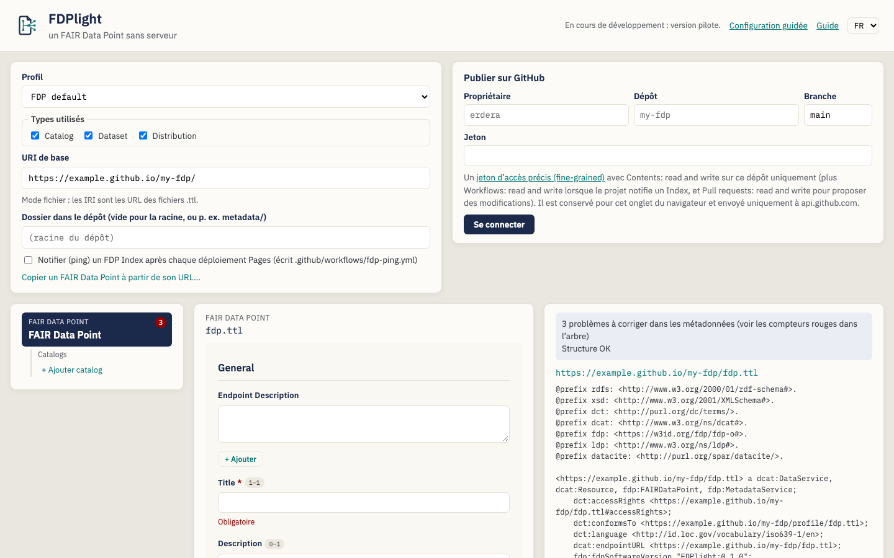
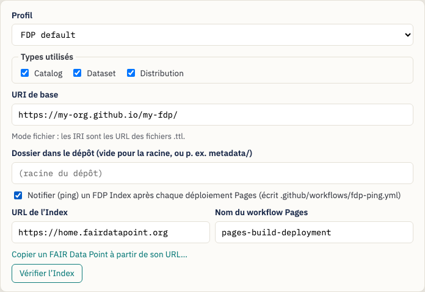
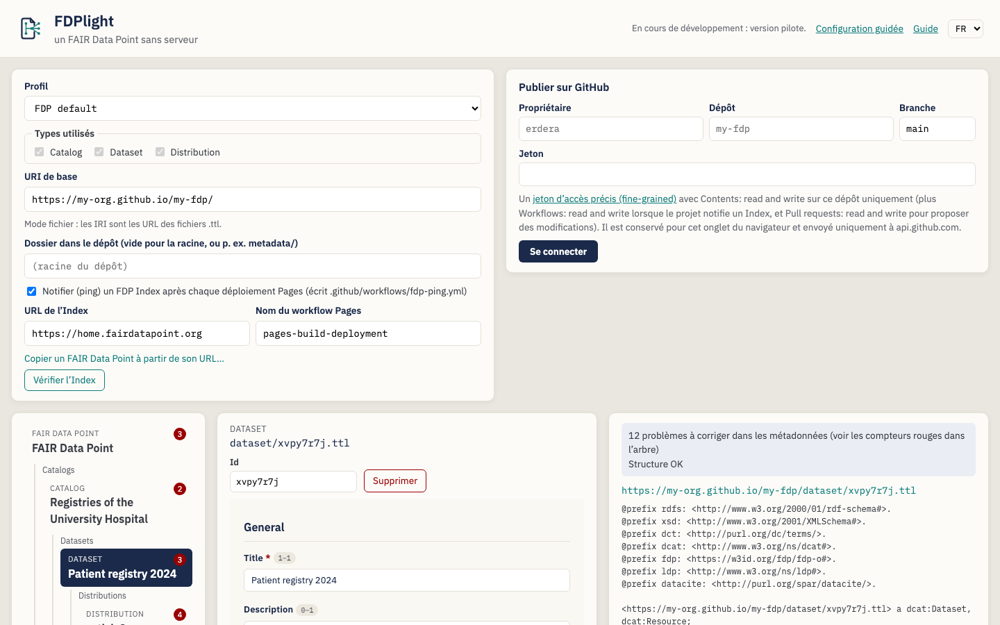
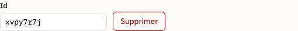
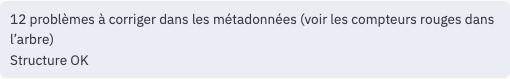
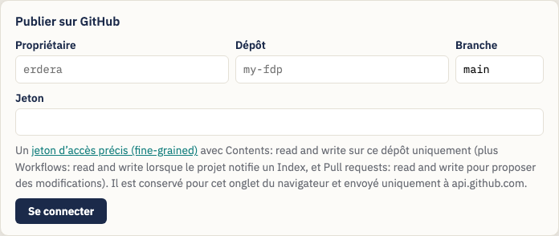
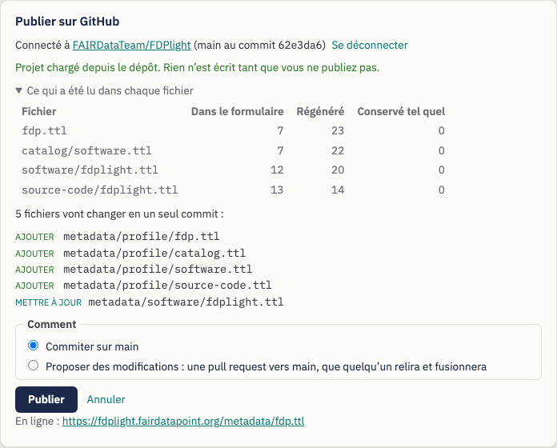
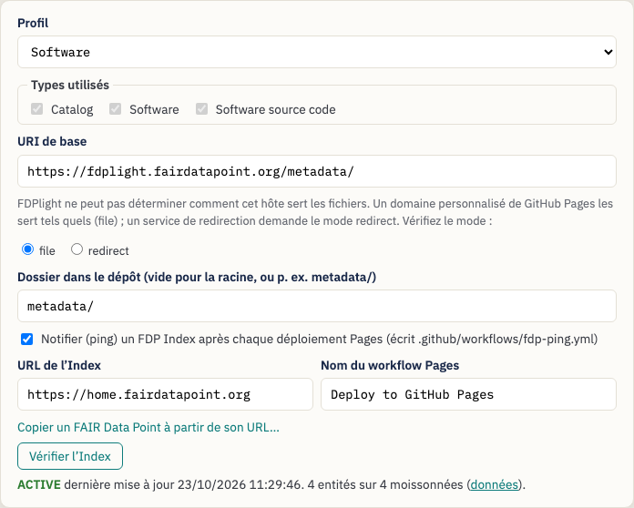
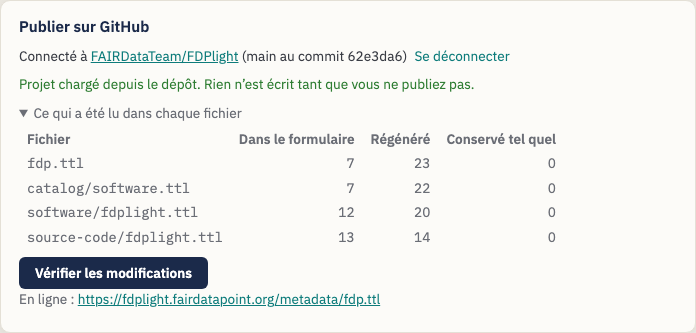

# Publier un FAIR Data Point avec FDPlight — Guide pour les data stewards

> Cette traduction n’a pas encore été relue par un locuteur natif. Le guide en
> anglais fait foi : [English](data-steward-guide.md).

**FDPlight** publie un [FAIR Data Point](https://www.fairdatapoint.org/)
(FDP) sans serveur. Vous décrivez vos catalogues, jeux de données et
distributions dans des formulaires ; FDPlight écrit un fichier Turtle par
description, les relie entre eux comme le fait un FDP, et les commite dans un
dépôt GitHub. GitHub Pages sert les fichiers, et un FDP Index peut les trouver
et les moissonner.

> *Le slogan de FDPlight : **un FAIR Data Point sans serveur.***

Ce guide s’adresse aux **data stewards** qui veulent que les métadonnées de
leur organisation soient trouvables via les FAIR Data Point Indexes, sans
faire tourner ni maintenir de serveur FDP.

> **Aucune installation.** FDPlight est une page web :
> <https://fdplight.fairdatapoint.org/>. Tout se passe dans votre navigateur ;
> le seul service avec lequel il communique pendant que vous éditez est GitHub.

---

## Table des matières

1. [Notions clés](#1-notions-clés)
2. [Avant de commencer](#2-avant-de-commencer)
3. [Tutoriel : publier votre premier FAIR Data Point](#3-tutoriel--publier-votre-premier-fair-data-point)
   - [Étape 1 — Paramètres du projet](#étape-1--paramètres-du-projet)
   - [Étape 2 — Décrire le FAIR Data Point lui-même](#étape-2--décrire-le-fair-data-point-lui-même)
   - [Étape 3 — Ajouter des catalogues, des jeux de données et des distributions](#étape-3--ajouter-des-catalogues-des-jeux-de-données-et-des-distributions)
   - [Étape 4 — Corriger ce que signalent les vérifications](#étape-4--corriger-ce-que-signalent-les-vérifications)
   - [Étape 5 — Se connecter à GitHub](#étape-5--se-connecter-à-github)
   - [Étape 6 — Vérifier et publier](#étape-6--vérifier-et-publier)
   - [Étape 7 — Vérifier l’Index](#étape-7--vérifier-lindex)
4. [Modifier plus tard](#4-modifier-plus-tard)
5. [Importer un FAIR Data Point existant](#5-importer-un-fair-data-point-existant)
6. [Profils : quels formulaires vous obtenez](#6-profils--quels-formulaires-vous-obtenez)
7. [Conseils et dépannage](#7-conseils-et-dépannage)

---

## 1. Notions clés

| Terme | Ce qu’il signifie dans FDPlight |
|---|---|
| **FAIR Data Point (FDP)** | Un arbre d’enregistrements de métadonnées : le FDP lui-même à la racine, puis les catalogues, les jeux de données, les distributions (ou d’autres types définis par votre profil). |
| **Entité** | Un enregistrement de cet arbre. Chaque entité est **un fichier Turtle** dans votre dépôt, p. ex. `catalog/rare-diseases.ttl`. |
| **URI de base** | L’endroit où vos fichiers sont servis, p. ex. `https://my-org.github.io/my-fdp/`. L’IRI de chaque entité commence par lui. |
| **IRI** | L’identifiant d’une entité. Dans le *mode fichier* habituel, c’est simplement l’URL de son fichier, p. ex. `https://my-org.github.io/my-fdp/catalog/rare-diseases.ttl`. |
| **Profil** | L’ensemble des types d’entités et de leurs formulaires (shapes SHACL). Par défaut, c’est le profil propre au FAIR Data Point ; vous pouvez aussi importer le profil d’un FDP en service, ou en ouvrir un depuis des fichiers. |
| **Liens de structure** | Les liens dont un FDP a besoin entre ses enregistrements : liens parent et enfant, conteneurs LDP, identifiants, horodatages. FDPlight **les écrit tous pour vous** ; vous n’avez qu’à remplir les formulaires. |
| **FDP Index** | Un service, comme [home.fairdatapoint.org](https://home.fairdatapoint.org/), qui liste des FDP et moissonne leurs métadonnées. FDPlight peut mettre en place un *ping* automatique qui garde votre FDP dans la liste. |

## 2. Avant de commencer

Il vous faut :

- **Un dépôt GitHub** pour les métadonnées, par exemple `my-org/my-fdp`. Ce
  peut être un dépôt neuf et vide, ou un dépôt qui contient déjà autre chose :
  placez alors le FDP dans un dossier comme `metadata/`.
- **GitHub Pages activé** pour ce dépôt (*Settings → Pages*). Le choix
  habituel est *Deploy from a branch*, branche `main`, dossier `/`. Votre URI
  de base est alors `https://{owner}.github.io/{repository}/`, plus le
  dossier si vous en utilisez un. Si le site Pages a un domaine personnalisé
  (par exemple `https://fdp.example.org/`), utilisez plutôt ce domaine, et
  choisissez *file* quand FDPlight vous demande comment l’hôte sert les
  fichiers.
- **Un jeton d’accès personnel précis (fine-grained)** pour ce dépôt
  uniquement ([en créer un](https://github.com/settings/personal-access-tokens/new)) :
  - *Contents: read and write* — toujours ;
  - *Workflows: read and write* — si FDPlight doit notifier un FDP Index ;
  - *Pull requests: read and write* — si vous voulez proposer des
    modifications à relire au lieu de publier directement.

  Si le dépôt appartient à une organisation, celle-ci devra peut-être d’abord
  autoriser les jetons fine-grained, et un propriétaire devra peut-être
  approuver le vôtre.

FDPlight ne conserve le jeton que dans l’onglet actuel du navigateur et ne
l’envoie qu’à `api.github.com`. Fermer l’onglet l’efface.

## 3. Tutoriel : publier votre premier FAIR Data Point

Quand vous ouvrez FDPlight, vous voyez en haut les paramètres du projet et le
panneau de publication, et en dessous l’**arbre des entités** (à gauche), le
**formulaire** de l’entité sélectionnée (au milieu), et les **vérifications
et le fichier généré** (à droite).

**Configuration guidée (facultative).** Lors de votre première visite,
FDPlight vous propose une configuration guidée. Elle vous demande le dépôt
(propriétaire, nom, branche, dossier) et où vivent les IRI (l’adresse GitHub
Pages, un domaine personnalisé ou w3id.org), affiche l’URI de base qui en
découle, vous laisse choisir un profil et décider s’il faut notifier un FDP
Index, puis remplit les paramètres et le formulaire de connexion quand vous
cliquez sur *Terminer*. *Passer* laisse tout tel quel. Vous pouvez la rouvrir
avec *Configuration guidée* dans l’en-tête, ou suivre à la main les étapes 1
à 7 ci-dessous.

### Étape 1 — Paramètres du projet

- **Profil** — gardez *FDP default*, sauf si votre communauté en utilise un
  autre (voir la [section 6](#6-profils--quels-formulaires-vous-obtenez)).
- **URI de base** — l’endroit où GitHub Pages sert vos fichiers. FDPlight
  propose `https://{owner}.github.io/{repository}/` dès que vous vous
  connectez à GitHub. Il doit commencer par `https://` et se terminer par `/`.
  FDPlight indique quel *mode d’IRI* il utilise : pour les adresses
  `github.io`, c’est le *mode fichier*, où chaque IRI est l’URL de son
  fichier `.ttl`.
- **Dossier dans le dépôt** — laissez vide pour publier à la racine du
  dépôt, ou saisissez un dossier comme `metadata/`. L’URI de base doit alors
  l’inclure.
- **Notifier (ping) un FDP Index** — cochez cette case pour que FDPlight
  ajoute une petite GitHub Action (`.github/workflows/fdp-ping.yml`) qui
  signale votre FDP à l’Index après chaque déploiement Pages et tous les trois
  jours, afin qu’il reste *active*. Le *Nom du workflow Pages* est
  `pages-build-deployment` quand Pages déploie depuis une branche ; si votre
  dépôt a son propre workflow de déploiement, saisissez son nom.

### Étape 2 — Décrire le FAIR Data Point lui-même

La racine de l’arbre, *FAIR Data Point*, est sélectionnée. Remplissez son
formulaire : un titre, un éditeur, une version, et tout ce que votre profil
demande d’autre. Les champs marqués d’un astérisque rouge sont obligatoires.

### Étape 3 — Ajouter des catalogues, des jeux de données et des distributions

Utilisez les liens **+ Ajouter …** dans l’arbre. Chaque nouvelle entité est
aussitôt sélectionnée pour que vous puissiez remplir son formulaire ; l’arbre
affiche son titre dès qu’elle en a un.

Sous le type de l’entité et son nom de fichier, vous trouvez :

- **Id** — la dernière partie du nom de fichier et de l’IRI. FDPlight en
  invente un au hasard ; vous pouvez le remplacer par quelque chose de
  lisible, comme `patient-registry-2024`, **tant que l’entité n’est pas
  publiée**. Ensuite, l’id fait partie d’un IRI public et il est verrouillé.
- **Déplacer vers** — apparaît quand l’entité peut aller ailleurs, par
  exemple dans un second catalogue. Le déplacement conserve le fichier et
  l’IRI de l’entité ; il reste donc possible après la publication.
- **Supprimer** — retire l’entité et tout ce qui se trouve en dessous.

Vous pouvez parcourir l’arbre au clavier : **↑ ↓** pour l’entité précédente
ou suivante, **← →** pour le parent ou le premier enfant, **Home** et **End**
(Début et Fin) pour la première et la dernière.

### Étape 4 — Corriger ce que signalent les vérifications

FDPlight vérifie chaque entité par rapport à son profil pendant que vous
tapez.

- Les **nombres en rouge dans l’arbre** comptent les problèmes de chaque
  entité.
- Dans le formulaire, chaque problème apparaît sous son champ (par exemple
  *Obligatoire*).
- L’encadré en haut à droite fait le bilan : *N problèmes à corriger dans les
  métadonnées*, et indique si la **structure** est correcte (liens, IRI, type
  de la racine).

Sous les vérifications, vous voyez le **fichier Turtle exact** que FDPlight
publiera pour l’entité sélectionnée, y compris tous les liens de structure
qu’il ajoute.

Vous ne pouvez pas publier tant qu’il reste des problèmes : le panneau de
publication indique ce qu’il faut corriger d’abord.

### Étape 5 — Se connecter à GitHub

Saisissez le propriétaire, le dépôt, la branche (en général `main`) et votre
jeton, puis cliquez sur **Se connecter**.

- Si le dépôt contient déjà un projet FDPlight, FDPlight **le charge** :
  paramètres, profil, arbre et métadonnées proviennent des fichiers. Si vous
  aviez déjà saisi quelque chose, il vous demande confirmation avant de le
  remplacer.
- Si le dépôt n’a pas encore de FDP, rien ne change, et l’URI de base est
  proposé à partir du nom du dépôt.

### Étape 6 — Vérifier et publier

Cliquez sur **Vérifier les modifications**. FDPlight liste les fichiers qu’il
va ajouter, mettre à jour ou supprimer, puis vous laisse choisir **comment** :

- **Commiter sur `main`** — les modifications sont en ligne au prochain
  déploiement Pages, en général en une ou deux minutes.
- **Proposer des modifications** — FDPlight place le même commit sur une
  nouvelle branche et ouvre une **pull request**, pour qu’un collègue puisse
  d’abord la relire sur GitHub. Fusionner la pull request publie les
  modifications.

Après la publication, **Vérifier si c’est en ligne** récupère votre FDP à
l’URI de base. S’il n’est pas encore servi, FDPlight explique comment activer
GitHub Pages ; le premier déploiement prend une ou deux minutes. Quand vous
vous connectez à un dépôt qui contient déjà un FDP, FDPlight lance cette
vérification de lui-même.

Tout est écrit en **un seul commit**. FDPlight ne met à jour un fichier que si
son contenu change : la date *modified* d’un enregistrement ne change donc que
si l’enregistrement lui-même (ou sa liste d’enfants) a changé. Si quelqu’un
d’autre a publié sur la branche depuis votre connexion, rien n’est écrit :
reconnectez-vous pour charger ses modifications, puis refaites les vôtres.

### Étape 7 — Vérifier l’Index

Si le projet notifie un Index, un bouton **Vérifier l’Index** apparaît dans
les paramètres. Il indique si l’Index connaît votre FDP, son état, la date à
laquelle il l’a moissonné pour la dernière fois, et combien de vos entités il
contient.

Le premier ping a lieu après le premier déploiement Pages qui suit votre
publication ; le moissonnage prend encore quelques secondes. Un FDP qui n’est
pas notifié pendant une semaine devient *inactive* dans l’Index ; le workflow
de ping l’évite.

### IRI pérennes avec w3id.org (facultatif)

Un URI de base sur GitHub Pages lie chaque IRI au dépôt : si vous renommez
celui-ci ou déplacez les fichiers plus tard, tous les IRI changent. Avec un
URI de base sous [w3id.org](https://w3id.org/), comme
`https://w3id.org/my-org/my-fdp/`, les IRI restent les mêmes et w3id les redirige vers les fichiers sur GitHub
Pages (*mode redirection*).

- Saisissez l’URI de base w3id dans les paramètres. FDPlight passe en mode
  redirection et demande la **base de stockage**, l’adresse Pages des
  fichiers ; quand vous vous connectez au dépôt, il la remplit pour vous.
- Sous **Règles de redirection w3id**, saisissez votre nom, votre e-mail et
  votre nom d’utilisateur GitHub (w3id demande une personne responsable), puis
  copiez les règles. Forkez
  [perma-id/w3id.org](https://github.com/perma-id/w3id.org), créez le fichier
  que FDPlight indique (par exemple `ids/my-org/my-fdp/.htaccess`) avec les
  règles, et ouvrez une pull request. Les règles ne changent pas quand vous
  ajoutez des enregistrements.
- Tant que w3id n’a pas fusionné la pull request, les IRI ne fonctionnent pas.
  **Vérifier la redirection w3id** vous indique s’ils fonctionnent ; après la
  publication, FDPlight la vérifie aussi en même temps que *Vérifier si c’est
  en ligne*.

## 4. Modifier plus tard

Ouvrez FDPlight, connectez-vous au même dépôt, et le projet se charge depuis
les fichiers. FDPlight montre ce qu’il a lu dans chaque fichier :

- **Dans le formulaire** — les valeurs que vous pouvez modifier ;
- **Régénéré** — les liens de structure que FDPlight réécrit à chaque
  publication ;
- **Conservé tel quel** — tout ce pour quoi le formulaire n’a pas de champ.
  FDPlight ne le supprime jamais : il le réécrit sans changement.

Modifiez, puis cliquez sur **Vérifier les modifications** et publiez comme
avant. Republier sans modification ne change rien.

**Changer l’URI de base plus tard.** Une fois le FDP publié, un nouvel URI
de base (ou un passage entre le mode fichier et le mode redirection) change
tous les IRI. FDPlight vous demande confirmation avant de le faire, et met à
jour vos propres références aux enregistrements du projet. Les liens vers les
anciens IRI ailleurs cessent de fonctionner, et le FDP Index voit un nouveau
FAIR Data Point. Si vous risquez de déplacer les fichiers un jour, choisissez
dès le départ des IRI pérennes avec w3id.org.

## 5. Importer un FAIR Data Point existant

FDPlight peut reprendre un FDP à base de fichiers qu’il n’a pas créé, par
exemple un FDP écrit à la main. Connectez-vous à son dépôt ; s’il n’y a pas de
projet FDPlight, le panneau propose d’en **importer** un. Indiquez le chemin
du fichier racine (le fichier qui décrit le FDP lui-même) et choisissez :

- **Conserver les IRI existantes** (recommandé) — chaque enregistrement
  garde son fichier et son IRI : les identifiants et l’entrée dans l’Index
  restent valides. Les nouvelles entités suivent l’organisation de FDPlight.
- **Passer à l’organisation de FDPlight** — les enregistrements sont déplacés
  vers des fichiers comme `catalog/{id}.ttl` et tous les IRI changent. Les
  anciens fichiers restent dans le dépôt jusqu’à ce que vous les supprimiez.

Le rapport d’import liste tout ce que FDPlight a dû corriger ou n’a pas pu
lire, par exemple un conteneur partagé par deux fichiers ou un identifiant qui
ne correspond pas à son enregistrement. La première publication corrige les
liens de structure ; toutes les métadonnées sont conservées.

### Copier un FAIR Data Point à partir de son adresse

Si le FDP tourne ailleurs (un serveur FAIR Data Point, une adresse w3id, un
site web), utilisez **Copier un FAIR Data Point à partir de son URL…** dans
les paramètres du projet. Définissez d’abord l’URI de base : chaque
enregistrement reçoit un nouvel IRI sous celui-ci, et garde un lien vers son
ancien IRI (`prov:wasDerivedFrom`). L’original n’est pas modifié. FDPlight
laisse de côté ce que l’ancien serveur générait sur lui-même (ses métriques,
ses profils et la description de son API) et écrit les siens. Relisez
ensuite les formulaires : il manque souvent aux enregistrements des champs
que votre profil exige.

## 6. Profils : quels formulaires vous obtenez

Le paramètre **Profil** détermine quels types d’entités existent, comment ils
s’imbriquent et quels champs ont leurs formulaires.

- **FDP default** — le profil propre au FAIR Data Point : FAIR Data Point →
  catalogues → jeux de données → distributions.
- **Software** — FAIR Data Point → catalogues → logiciels → code source.
- **ERDERA** — le profil de la Virtual Platform ERDERA / EJP RD : FAIR Data
  Point → catalogues → jeux de données → distributions → services d’accès,
  et, sous un catalogue, également des registres de patients, des biobanques,
  des recommandations et des services de données. Chaque enregistrement
  déclare qu’il est visible par la Virtual Platform
  (`ejp:vpConnection ejp:VPDiscoverable`), sauf si vous choisissez de le
  masquer. Chaque service de données a besoin de son *Ontological Type* : la
  Virtual Platform ne liste les services de données que s’ils en ont un.
  Masquez les enregistrements avec prudence : avec les requêtes actuelles de
  la Virtual Platform, un enregistrement masqué peut aussi en masquer
  d’autres, et FDPlight affiche un avertissement sur un enregistrement
  masqué.

- **Importer depuis un FAIR Data Point…** — saisissez l’adresse d’un FDP en
  service (par exemple `https://home.fairdatapoint.org`) ; FDPlight reprend
  ses types d’entités et leurs shapes, pour que vos fichiers suivent le même
  profil.
- **Ouvrir depuis des fichiers…** — choisissez un profil conservé sur votre
  ordinateur : un fichier JSON avec les types (le `fdplight.json` d’un autre
  projet convient) et les fichiers de shapes Turtle qu’il désigne. FDPlight
  liste tout fichier manquant ou défectueux.

**Types utilisés.** Quand un profil a des types facultatifs, cochez ceux dont
vous avez besoin sous *Types utilisés* ; les autres ne sont pas proposés dans
l’arbre. Un type qui a déjà des enregistrements reste coché jusqu’à ce que
vous les supprimiez.

Changer de profil démarre un nouveau projet vide. Le profil est enregistré
dans le dépôt avec vos fichiers : toute personne qui se connecte ensuite
obtient les mêmes formulaires.

## 7. Conseils et dépannage

| Message ou symptôme | Que faire |
|---|---|
| *GitHub a refusé le jeton (401).* | Le jeton est incorrect ou expiré. Créez-en un nouveau. |
| *Dépôt ou branche introuvable, ou le jeton n’y a pas accès (404).* | Vérifiez l’orthographe, et que le jeton a bien été créé pour ce dépôt (et approuvé, pour une organisation). |
| *The branch has new commits …* | Quelqu’un d’autre a publié entre-temps. Reconnectez-vous, puis refaites vos modifications. |
| La publication échoue sur `.github/workflows/fdp-ping.yml` | Il manque au jeton la permission *Workflows: read and write*. |
| *… n’est pas encore sur le web.* | Activez GitHub Pages (*Settings → Pages → Deploy from a branch*) et suivez le déploiement Pages dans l’onglet *Actions*, puis cliquez sur *Vérifier à nouveau*. |
| L’Index ne liste pas le FDP | Attendez le déploiement Pages et le workflow *Ping FDP Index* dans l’onglet *Actions* ; vous pouvez aussi y lancer ce workflow à la main. |
| L’interface n’est pas dans la bonne langue | Utilisez le menu *Langue* en haut à droite. |
