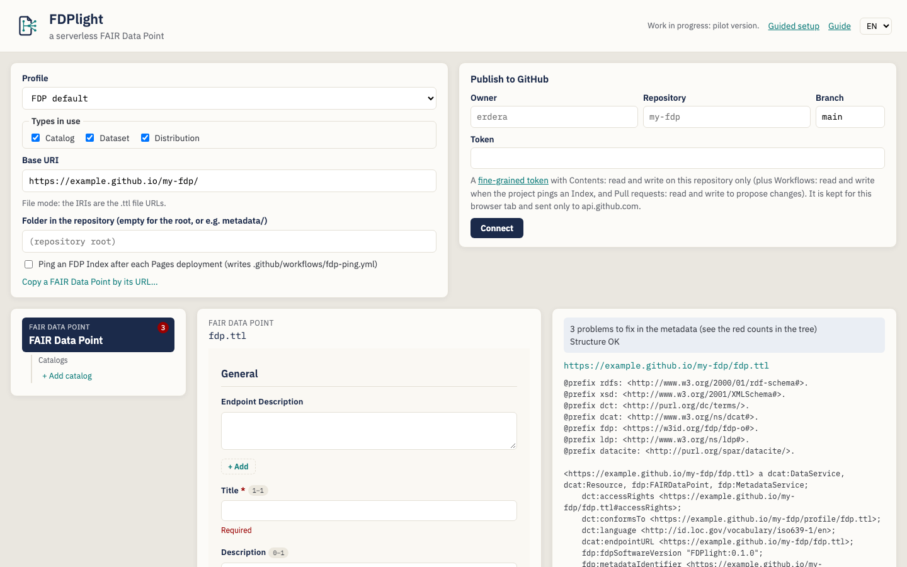
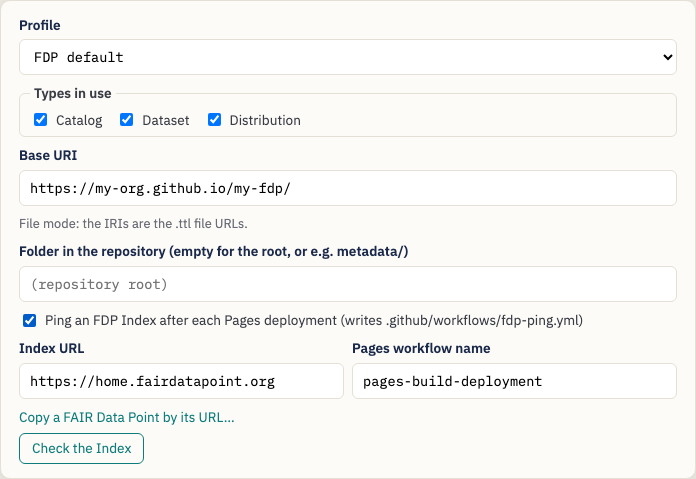
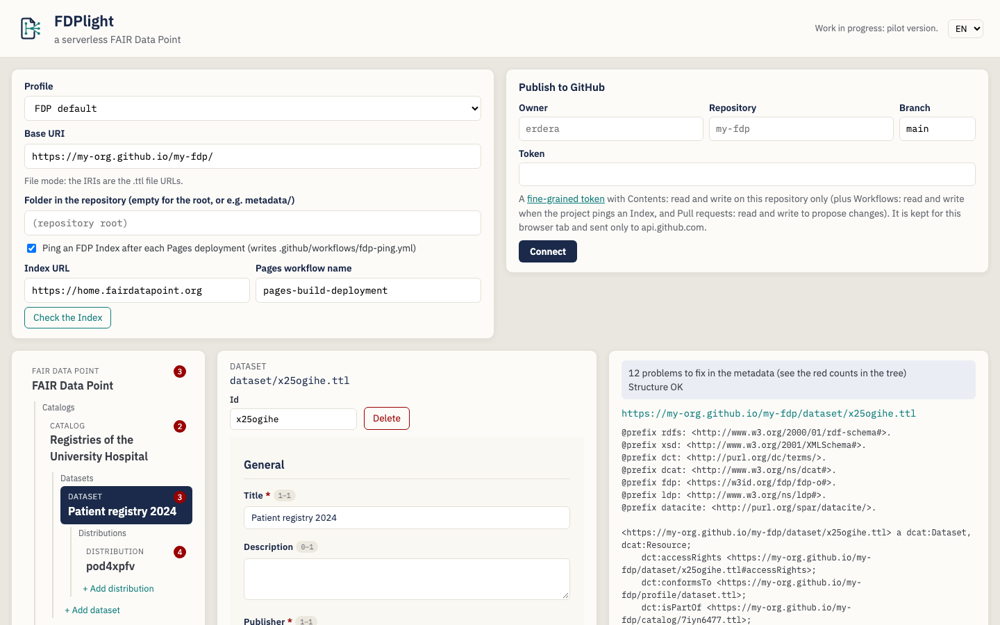
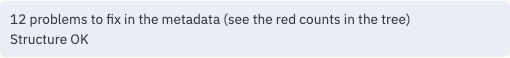
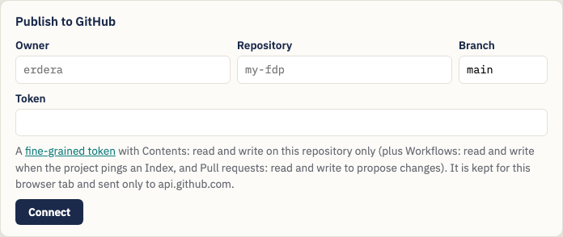
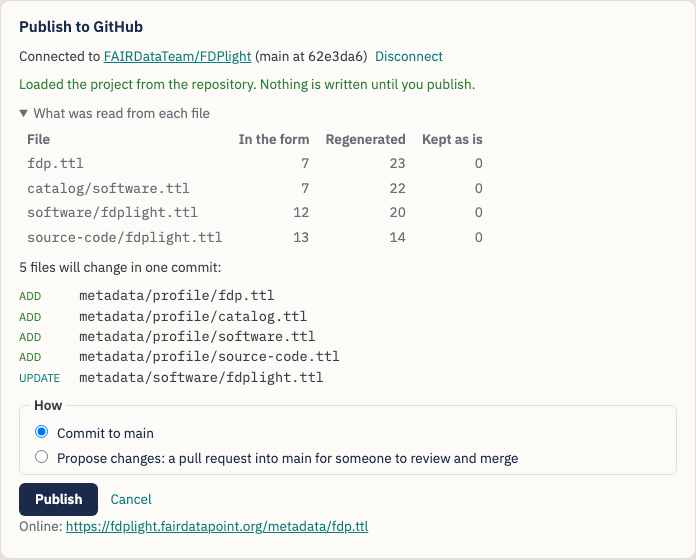
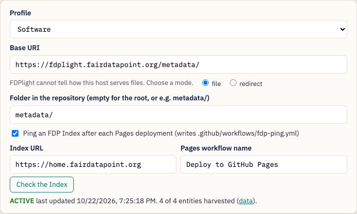
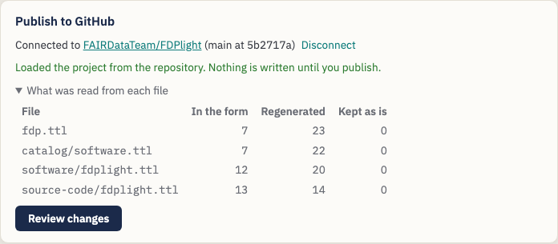

# Publishing a FAIR Data Point with FDPlight — A Guide for Data Stewards

**FDPlight** publishes a [FAIR Data Point](https://www.fairdatapoint.org/)
(FDP) without a server. You describe your catalogs, datasets and
distributions in forms; FDPlight writes one Turtle file per description,
wires them together the way an FDP does, and commits them to a GitHub
repository. GitHub Pages serves the files, and an FDP Index can find and
harvest them.

> *FDPlight's tagline: **a serverless FAIR Data Point.***

This guide is for **data stewards** who want their organisation's metadata
to be findable through FAIR Data Point Indexes, without running or
maintaining an FDP server.

> **No installation.** FDPlight is a web page:
> <https://fdplight.fairdatapoint.org/>. Everything happens in your browser;
> the only service it talks to while you edit is GitHub.

---

## Table of contents

1. [Key concepts](#1-key-concepts)
2. [Before you start](#2-before-you-start)
3. [Tutorial: publish your first FAIR Data Point](#3-tutorial-publish-your-first-fair-data-point)
   - [Step 1 — Project settings](#step-1--project-settings)
   - [Step 2 — Describe the FAIR Data Point itself](#step-2--describe-the-fair-data-point-itself)
   - [Step 3 — Add catalogs, datasets and distributions](#step-3--add-catalogs-datasets-and-distributions)
   - [Step 4 — Fix what the checks report](#step-4--fix-what-the-checks-report)
   - [Step 5 — Connect to GitHub](#step-5--connect-to-github)
   - [Step 6 — Review and publish](#step-6--review-and-publish)
   - [Step 7 — Check the Index](#step-7--check-the-index)
4. [Editing later](#4-editing-later)
5. [Importing an existing FAIR Data Point](#5-importing-an-existing-fair-data-point)
6. [Profiles: which forms you get](#6-profiles-which-forms-you-get)
7. [Tips and troubleshooting](#7-tips-and-troubleshooting)

---

## 1. Key concepts

| Term | What it means in FDPlight |
|---|---|
| **FAIR Data Point (FDP)** | A tree of metadata records: the FDP itself at the root, then catalogs, datasets, distributions (or other types your profile defines). |
| **Entity** | One record in that tree. Each entity is **one Turtle file** in your repository, e.g. `catalog/rare-diseases.ttl`. |
| **Base URI** | Where your files are served, e.g. `https://my-org.github.io/my-fdp/`. Every entity's IRI starts with it. |
| **IRI** | The identifier of an entity. In the usual *file mode* it is simply the URL of its file, e.g. `https://my-org.github.io/my-fdp/catalog/rare-diseases.ttl`. |
| **Profile** | The set of entity types and their forms (SHACL shapes). The default is the FAIR Data Point's own profile; you can also import the profile of a running FDP. |
| **Wiring** | The links an FDP needs between records: parent and child links, LDP containers, identifiers, timestamps. FDPlight **writes all of it for you**; you only fill in the forms. |
| **FDP Index** | A service, such as [home.fairdatapoint.org](https://home.fairdatapoint.org/), that lists FDPs and harvests their metadata. FDPlight can set up an automatic *ping* that keeps your FDP listed. |

## 2. Before you start

You need:

- **A GitHub repository** for the metadata, for example `my-org/my-fdp`. It
  can be a new, empty repository or one that already has other content: put
  the FDP in a folder such as `metadata/`.
- **GitHub Pages switched on** for that repository (*Settings → Pages*).
  The usual choice is *Deploy from a branch*, branch `main`, folder `/`.
  Your base URI is then `https://{owner}.github.io/{repository}/`, plus the
  folder if you use one.
- **A fine-grained personal access token** for that repository only
  ([create one](https://github.com/settings/personal-access-tokens/new)):
  - *Contents: read and write* — always;
  - *Workflows: read and write* — if FDPlight should ping an FDP Index;
  - *Pull requests: read and write* — if you want to propose changes for
    review instead of publishing directly.

  If the repository belongs to an organisation, the organisation may first
  have to allow fine-grained tokens, and an owner may have to approve yours.

FDPlight keeps the token only in the current browser tab and sends it only
to `api.github.com`. Closing the tab forgets it.

## 3. Tutorial: publish your first FAIR Data Point

When you open FDPlight you see the project settings and the publishing
panel at the top, and below them the **entity tree** (left), the **form**
of the selected entity (middle), and the **checks and the generated file**
(right).

### Step 1 — Project settings

- **Profile** — keep *FDP default* unless your community uses another one
  (see [section 6](#6-profiles-which-forms-you-get)).
- **Base URI** — where GitHub Pages serves your files. FDPlight proposes
  `https://{owner}.github.io/{repository}/` once you connect to GitHub. It
  must start with `https://` and end with `/`. FDPlight shows which *IRI
  mode* it uses: for `github.io` addresses that is *file mode*, where each
  IRI is the URL of its `.ttl` file.
- **Folder in the repository** — leave empty to publish at the root of the
  repository, or enter a folder such as `metadata/`. The base URI must then
  include it.
- **Ping an FDP Index** — tick it to have FDPlight add a small GitHub
  Action (`.github/workflows/fdp-ping.yml`) that tells the Index about your
  FDP after every Pages deployment and every three days, so it stays
  *active*. The *Pages workflow name* is `pages-build-deployment` when Pages
  deploys from a branch; if your repository has its own deploy workflow,
  enter its name.

### Step 2 — Describe the FAIR Data Point itself

The root of the tree, *FAIR Data Point*, is selected. Fill in its form:
a title, a publisher, a version, and anything else your profile asks for.
Fields marked with a red asterisk are required.

### Step 3 — Add catalogs, datasets and distributions

Use the **+ Add …** links in the tree. Each new entity is selected at once
so you can fill in its form; the tree shows its title as soon as it has
one.

Under the entity type and its file name you find:

- **Id** — the last part of the file name and IRI. FDPlight makes up a
  random one; you can replace it with something readable, such as
  `patient-registry-2024`, **until the entity is published**. After that
  the id is part of a public IRI and is locked.
- **Move to** — appears when there is another place the entity could go,
  for example a second catalog. Moving keeps the entity's file and IRI, so
  it is allowed after publishing too.
- **Delete** — removes the entity and everything below it.

You can move through the tree with the keyboard: **↑ ↓** to the previous or
next entity, **← →** to the parent or the first child, **Home** and **End**
to the first and last.

### Step 4 — Fix what the checks report

FDPlight checks every entity against its profile while you type.

- The **red numbers in the tree** count the problems per entity.
- In the form, each problem appears under its field (for example
  *Required*).
- The box at the top right sums up: *N problems to fix in the metadata*,
  and whether the **structure** is fine (links, IRIs, the root's type).

Below the checks you see the **exact Turtle file** FDPlight will publish
for the selected entity, including all the wiring it adds.

You cannot publish while there are problems: the publishing panel says
what to fix first.

### Step 5 — Connect to GitHub

Enter the owner, the repository, the branch (usually `main`) and your
token, then **Connect**.

- If the repository already has an FDPlight project, FDPlight **loads it**:
  settings, profile, tree and metadata come from the files. If you had
  already typed something, it asks before replacing it.
- If the repository has no FDP yet, nothing changes, and the base URI is
  proposed from the repository name.

### Step 6 — Review and publish

Click **Review changes**. FDPlight lists the files it will add, update or
remove, then lets you choose **how**:

- **Commit to `main`** — the changes go live with the next Pages
  deployment, usually within a minute or two.
- **Propose changes** — FDPlight puts the same commit on a new branch and
  opens a **pull request**, so a colleague can review it on GitHub first.
  Merging the pull request publishes the changes.

After publishing, **Check whether it is online** fetches your FDP from the
base URI. If it is not served yet, FDPlight shows how to switch on GitHub
Pages; the first deployment takes a minute or two. When you connect to a
repository that already has an FDP, FDPlight runs this check by itself.

Everything is written as **one commit**. FDPlight only updates a file when
its content changes, so the *modified* date of a record changes only when
the record itself (or its list of children) changed. If someone else
published to the branch since you connected, nothing is written: reconnect
to load their changes, then apply yours again.

### Step 7 — Check the Index

If the project pings an Index, a **Check the Index** button appears in the
settings. It shows whether the Index knows your FDP, its state, when it
last harvested it, and how many of your entities it has.

The first ping happens after the first Pages deployment that follows your
publish; harvesting takes a few more seconds. An FDP that is not pinged for
a week becomes *inactive* in the Index; the ping workflow prevents that.

## 4. Editing later

Open FDPlight, connect to the same repository, and the project loads from
the files. FDPlight shows what it read from each file:

- **In the form** — values you can edit;
- **Regenerated** — the wiring FDPlight writes anew on every publish;
- **Kept as is** — anything the form has no field for. FDPlight never drops
  it: it is written back unchanged.

Edit, then **Review changes** and publish as before. Publishing again
without edits changes nothing.

## 5. Importing an existing FAIR Data Point

FDPlight can take over a file-based FDP it did not make, for example one
written by hand. Connect to its repository; if there is no FDPlight project
there, the panel offers to **import** one. Give the path of the root file
(the file that describes the FDP itself) and choose:

- **Keep the existing IRIs** (recommended) — every record keeps its file
  and IRI, so identifiers and the Index entry stay valid. New entities use
  FDPlight's layout.
- **Move to FDPlight's layout** — records move to files such as
  `catalog/{id}.ttl` and all IRIs change. The old files stay in the
  repository until you delete them.

The import report lists anything FDPlight had to fix or could not read,
for example a container shared by two files or an identifier that does not
match its record. The first publish fixes the wiring; all metadata is kept.

### Copying a FAIR Data Point from its address

If the FDP runs somewhere else (a FAIR Data Point server, a w3id address, a
website), use **Copy a FAIR Data Point by its URL…** in the project
settings. Set the base URI first: every record gets a new IRI under it, and
keeps a link to its old IRI (`prov:wasDerivedFrom`). The original is not
changed. FDPlight leaves out what the old server generated about itself
(its metrics, profiles and API description) and writes its own. Review the
forms afterwards: records often miss fields your profile requires.

## 6. Profiles: which forms you get

The **Profile** setting decides which entity types exist, how they nest,
and which fields their forms have.

- **FDP default** — the FAIR Data Point's own profile: FAIR Data Point →
  catalogs → datasets → distributions.
- **Software** — FAIR Data Point → catalogs → software → source code.
- **Import from a FAIR Data Point…** — enter the address of a running FDP
  (for example `https://home.fairdatapoint.org`); FDPlight takes its entity
  types and their shapes, so your files follow the same profile.

Switching the profile starts a new, empty project. The profile is saved in
the repository with your files, so everyone who connects later gets the
same forms.

## 7. Tips and troubleshooting

| Message or symptom | What to do |
|---|---|
| *GitHub rejected the token (401).* | The token is wrong or expired. Create a new one. |
| *Repository or branch not found, or the token cannot access it (404).* | Check the spelling, and that the token was created for this repository (and approved, for an organisation). |
| *The branch has new commits …* | Someone else published meanwhile. Reconnect, then make your edits again. |
| Publishing fails on `.github/workflows/fdp-ping.yml` | The token lacks *Workflows: read and write*. |
| *… is not on the web yet.* | Switch on GitHub Pages (*Settings → Pages → Deploy from a branch*) and look at the *Actions* tab for the Pages deployment, then *Check again*. |
| The Index does not list the FDP | Wait for the Pages deployment and the *Ping FDP Index* workflow in the *Actions* tab; you can also run that workflow by hand there. |
| The interface is in the wrong language | Use the language menu at the top right. |
