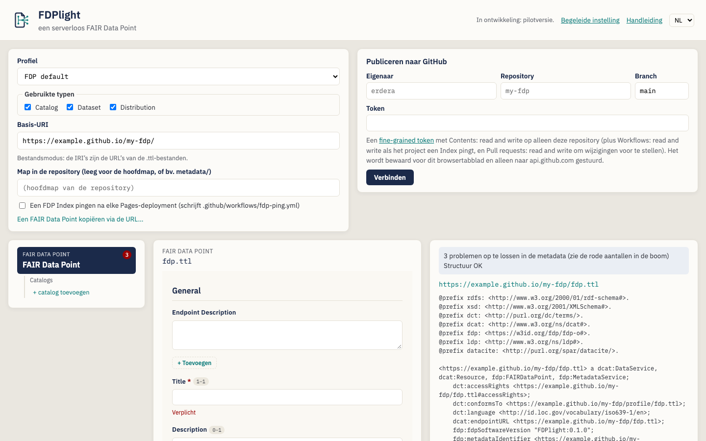
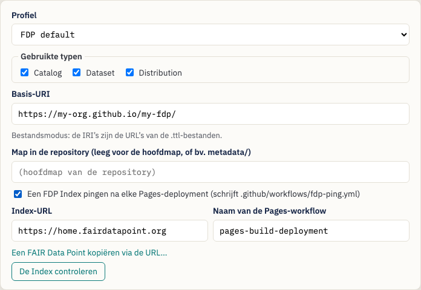
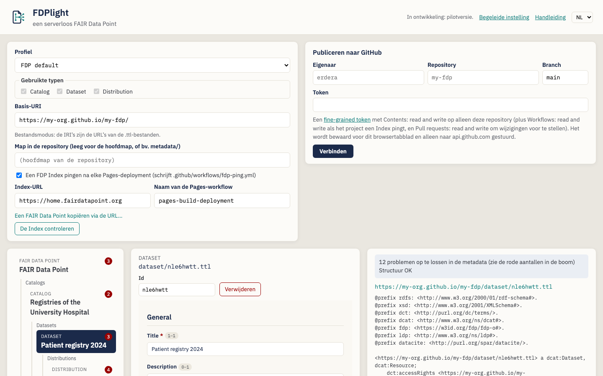
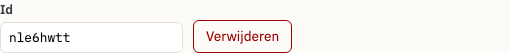
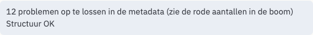
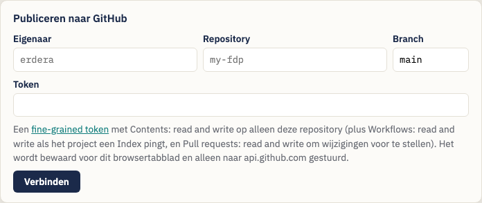
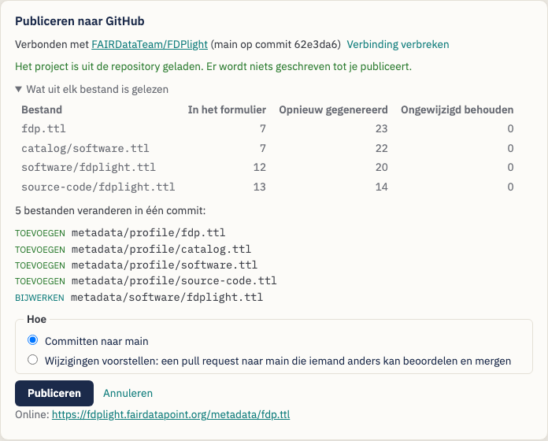
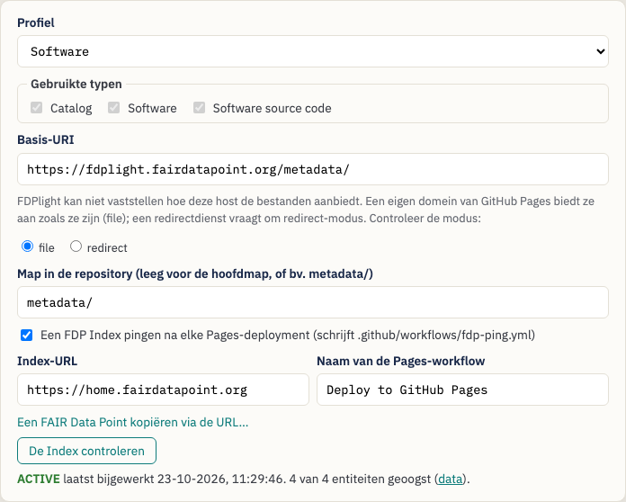
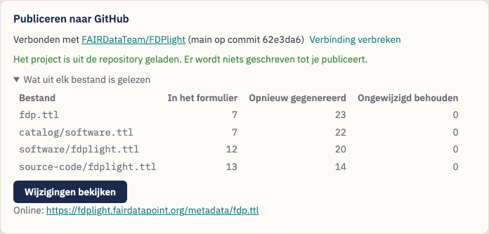

# Een FAIR Data Point publiceren met FDPlight — Een handleiding voor datastewards

> Dit is een vertaling die nog niet door een moedertaalspreker is
> nagekeken. De Engelse handleiding is leidend:
> [English](data-steward-guide.md).

**FDPlight** publiceert een [FAIR Data Point](https://www.fairdatapoint.org/)
(FDP) zonder server. U beschrijft uw catalogi, datasets en distributies in
formulieren; FDPlight schrijft per beschrijving één Turtle-bestand, verbindt
ze met elkaar zoals een FDP dat doet, en commit ze naar een
GitHub-repository. GitHub Pages biedt de bestanden aan, en een FDP Index kan
ze vinden en oogsten.

> *De slogan van FDPlight: **een serverloos FAIR Data Point.***

Deze handleiding is bedoeld voor **datastewards** die de metadata van hun
organisatie vindbaar willen maken via FAIR Data Point Indexes, zonder zelf
een FDP-server te draaien of te onderhouden.

> **Geen installatie.** FDPlight is een webpagina:
> <https://fdplight.fairdatapoint.org/>. Alles gebeurt in uw browser; de
> enige dienst waarmee het praat terwijl u bewerkt, is GitHub.

---

## Inhoudsopgave

1. [Kernbegrippen](#1-kernbegrippen)
2. [Voordat u begint](#2-voordat-u-begint)
3. [Tutorial: uw eerste FAIR Data Point publiceren](#3-tutorial-uw-eerste-fair-data-point-publiceren)
   - [Stap 1 — Projectinstellingen](#stap-1--projectinstellingen)
   - [Stap 2 — Het FAIR Data Point zelf beschrijven](#stap-2--het-fair-data-point-zelf-beschrijven)
   - [Stap 3 — Catalogi, datasets en distributies toevoegen](#stap-3--catalogi-datasets-en-distributies-toevoegen)
   - [Stap 4 — Oplossen wat de controles melden](#stap-4--oplossen-wat-de-controles-melden)
   - [Stap 5 — Verbinding maken met GitHub](#stap-5--verbinding-maken-met-github)
   - [Stap 6 — Bekijken en publiceren](#stap-6--bekijken-en-publiceren)
   - [Stap 7 — De Index controleren](#stap-7--de-index-controleren)
4. [Later bewerken](#4-later-bewerken)
5. [Een bestaand FAIR Data Point importeren](#5-een-bestaand-fair-data-point-importeren)
6. [Profielen: welke formulieren u krijgt](#6-profielen-welke-formulieren-u-krijgt)
7. [Tips en probleemoplossing](#7-tips-en-probleemoplossing)

---

## 1. Kernbegrippen

| Begrip | Wat het betekent in FDPlight |
|---|---|
| **FAIR Data Point (FDP)** | Een boom van metadatarecords: het FDP zelf als hoofdentiteit, daaronder catalogi, datasets, distributies (of andere typen die uw profiel definieert). |
| **Entiteit** | Eén record in die boom. Elke entiteit is **één Turtle-bestand** in uw repository, bijvoorbeeld `catalog/rare-diseases.ttl`. |
| **Basis-URI** | Waar uw bestanden worden aangeboden, bijvoorbeeld `https://my-org.github.io/my-fdp/`. De IRI van elke entiteit begint hiermee. |
| **IRI** | De identifier van een entiteit. In de gebruikelijke *bestandsmodus* is dat gewoon de URL van het bestand, bijvoorbeeld `https://my-org.github.io/my-fdp/catalog/rare-diseases.ttl`. |
| **Profiel** | De verzameling entiteitstypen en hun formulieren (SHACL-shapes). Standaard is dat het eigen profiel van het FAIR Data Point; u kunt ook het profiel van een draaiend FDP importeren, of er een openen uit bestanden. |
| **Bedrading** | De koppelingen die een FDP tussen records nodig heeft: links naar ouder en kinderen, LDP-containers, identifiers, tijdstempels. FDPlight **schrijft dit allemaal voor u**; u vult alleen de formulieren in. |
| **FDP Index** | Een dienst, zoals [home.fairdatapoint.org](https://home.fairdatapoint.org/), die FDP's opsomt en hun metadata oogst. FDPlight kan een automatische *ping* instellen die uw FDP in de lijst houdt. |

## 2. Voordat u begint

U hebt nodig:

- **Een GitHub-repository** voor de metadata, bijvoorbeeld `my-org/my-fdp`.
  Dat kan een nieuwe, lege repository zijn of een die al andere inhoud
  heeft: zet het FDP dan in een map zoals `metadata/`.
- **GitHub Pages ingeschakeld** voor die repository (*Settings → Pages*).
  De gebruikelijke keuze is *Deploy from a branch*, branch `main`, map `/`.
  Uw basis-URI is dan `https://{owner}.github.io/{repository}/`, plus de map
  als u er een gebruikt. Heeft de Pages-site een eigen domein (bijvoorbeeld
  `https://fdp.example.org/`), gebruik dan dat domein, en kies *file* als
  FDPlight vraagt hoe de host de bestanden aanbiedt.
- **Een fine-grained personal access token** voor alleen die repository
  ([maak er een aan](https://github.com/settings/personal-access-tokens/new)):
  - *Contents: read and write* — altijd;
  - *Workflows: read and write* — als FDPlight een FDP Index moet pingen;
  - *Pull requests: read and write* — als u wijzigingen ter beoordeling wilt
    voorstellen in plaats van ze direct te publiceren.

  Hoort de repository bij een organisatie, dan moet die organisatie
  fine-grained tokens misschien eerst toestaan, en moet een eigenaar uw
  token misschien goedkeuren.

FDPlight bewaart het token alleen in het huidige browsertabblad en stuurt
het alleen naar `api.github.com`. Sluit u het tabblad, dan is het token
vergeten.

## 3. Tutorial: uw eerste FAIR Data Point publiceren

Als u FDPlight opent, ziet u bovenaan de projectinstellingen en het
publicatiepaneel, en daaronder de **entiteitenboom** (links), het
**formulier** van de geselecteerde entiteit (midden) en de **controles en
het gegenereerde bestand** (rechts).

**Begeleide instelling (optioneel).** Bij uw eerste bezoek biedt FDPlight
een begeleide instelling aan. Die vraagt naar de repository (eigenaar, naam,
branch, map), toont de basis-URI die daaruit volgt, laat u een profiel kiezen
en of u een FDP Index wilt pingen, en vult de instellingen en het
verbindingsformulier in als u op *Voltooien* klikt. *Overslaan* laat alles
zoals het was. U kunt de begeleide instelling opnieuw openen via
*Begeleide instelling* in de kopbalk, of de stappen 1 tot en met 7 hieronder
met de hand volgen.

### Stap 1 — Projectinstellingen

- **Profiel** — houd *FDP default* aan, tenzij uw gemeenschap een ander
  profiel gebruikt (zie [sectie 6](#6-profielen-welke-formulieren-u-krijgt)).
- **Basis-URI** — waar GitHub Pages uw bestanden aanbiedt. FDPlight stelt
  `https://{owner}.github.io/{repository}/` voor zodra u verbinding maakt
  met GitHub. De basis-URI moet beginnen met `https://` en eindigen op `/`.
  FDPlight toont welke *IRI-modus* het gebruikt: voor `github.io`-adressen
  is dat de *bestandsmodus*, waarin elke IRI de URL van het bijbehorende
  `.ttl`-bestand is.
- **Map in de repository** — laat leeg om in de hoofdmap van de repository
  te publiceren, of vul een map in zoals `metadata/`. De basis-URI moet die
  map dan bevatten.
- **Een FDP Index pingen** — vink dit aan om FDPlight een kleine GitHub
  Action (`.github/workflows/fdp-ping.yml`) te laten toevoegen die de Index
  na elke Pages-deployment en elke drie dagen over uw FDP inlicht, zodat het
  *active* blijft. De *Naam van de Pages-workflow* is
  `pages-build-deployment` als Pages vanuit een branch deployt; heeft uw
  repository een eigen deploy-workflow, vul dan de naam daarvan in.

### Stap 2 — Het FAIR Data Point zelf beschrijven

De hoofdentiteit van de boom, *FAIR Data Point*, is geselecteerd. Vul het
formulier in: een titel, een uitgever, een versie, en wat uw profiel verder
vraagt. Velden met een rood sterretje zijn verplicht.

### Stap 3 — Catalogi, datasets en distributies toevoegen

Gebruik de links **+ … toevoegen** in de boom. Elke nieuwe entiteit wordt
meteen geselecteerd, zodat u het formulier kunt invullen; de boom toont de
titel zodra die er is.

Onder het entiteitstype en de bestandsnaam vindt u:

- **Id** — het laatste deel van de bestandsnaam en de IRI. FDPlight
  verzint een willekeurige id; u kunt die vervangen door iets leesbaars,
  zoals `patient-registry-2024`, **tot de entiteit is gepubliceerd**. Daarna
  is de id onderdeel van een openbare IRI en ligt hij vast.
- **Verplaatsen naar** — verschijnt als er een andere plek is waar de
  entiteit kan staan, bijvoorbeeld een tweede catalogus. Verplaatsen behoudt
  het bestand en de IRI van de entiteit, dus het mag ook na publicatie.
- **Verwijderen** — verwijdert de entiteit en alles eronder.

U kunt met het toetsenbord door de boom gaan: **↑ ↓** naar de vorige of
volgende entiteit, **← →** naar de ouder of het eerste kind, **Home** en
**End** naar de eerste en de laatste.

### Stap 4 — Oplossen wat de controles melden

FDPlight controleert elke entiteit tegen het profiel terwijl u typt.

- De **rode getallen in de boom** tellen de problemen per entiteit.
- In het formulier staat elk probleem onder het bijbehorende veld
  (bijvoorbeeld *Verplicht*).
- Het vak rechtsboven vat samen: *N problemen op te lossen in de metadata*,
  en of de **structuur** in orde is (links, IRI's, het type van de
  hoofdentiteit).

Onder de controles ziet u het **exacte Turtle-bestand** dat FDPlight voor de
geselecteerde entiteit zal publiceren, inclusief alle bedrading die het
toevoegt.

U kunt niet publiceren zolang er problemen zijn: het publicatiepaneel zegt
wat u eerst moet oplossen.

### Stap 5 — Verbinding maken met GitHub

Vul de eigenaar, de repository, de branch (meestal `main`) en uw token in,
en klik op **Verbinden**.

- Heeft de repository al een FDPlight-project, dan **laadt** FDPlight het:
  instellingen, profiel, boom en metadata komen uit de bestanden. Had u al
  iets ingevoerd, dan vraagt FDPlight dit eerst voordat het uw invoer
  vervangt.
- Heeft de repository nog geen FDP, dan verandert er niets, en wordt de
  basis-URI voorgesteld op basis van de naam van de repository.

### Stap 6 — Bekijken en publiceren

Klik op **Wijzigingen bekijken**. FDPlight toont de bestanden die het zal
toevoegen, bijwerken of verwijderen, en laat u dan kiezen **hoe**:

- **Committen naar `main`** — de wijzigingen gaan live met de volgende
  Pages-deployment, meestal binnen een minuut of twee.
- **Wijzigingen voorstellen** — FDPlight zet dezelfde commit op een nieuwe
  branch en opent een **pull request**, zodat een collega die eerst op
  GitHub kan beoordelen. Door de pull request te mergen worden de
  wijzigingen gepubliceerd.

Na het publiceren haalt **Controleren of het online is** uw FDP op via de
basis-URI. Wordt het nog niet aangeboden, dan laat FDPlight zien hoe u
GitHub Pages inschakelt; de eerste deployment duurt een minuut of twee.
Maakt u verbinding met een repository die al een FDP heeft, dan voert
FDPlight deze controle zelf uit.

Alles wordt geschreven als **één commit**. FDPlight werkt een bestand alleen
bij als de inhoud verandert, dus de *modified*-datum van een record
verandert alleen als het record zelf (of de lijst van zijn kinderen) is
veranderd. Heeft iemand anders sinds uw verbinding naar de branch
gepubliceerd, dan wordt er niets geschreven: maak opnieuw verbinding om
diens wijzigingen te laden en breng daarna uw eigen wijzigingen opnieuw aan.

### Stap 7 — De Index controleren

Pingt het project een Index, dan verschijnt er in de instellingen een knop
**De Index controleren**. Die laat zien of de Index uw FDP kent, wat de
status is, wanneer de Index het voor het laatst heeft geoogst, en hoeveel
van uw entiteiten hij heeft.

De eerste ping volgt na de eerste Pages-deployment na uw publicatie; het
oogsten duurt daarna nog enkele seconden. Een FDP dat een week lang niet
wordt gepingd, wordt in de Index *inactive*; de ping-workflow voorkomt dat.

## 4. Later bewerken

Open FDPlight, maak verbinding met dezelfde repository, en het project wordt
uit de bestanden geladen. FDPlight toont wat het uit elk bestand heeft
gelezen:

- **In het formulier** — waarden die u kunt bewerken;
- **Opnieuw gegenereerd** — de bedrading die FDPlight bij elke publicatie
  opnieuw schrijft;
- **Ongewijzigd behouden** — alles waarvoor het formulier geen veld heeft.
  FDPlight laat dit nooit weg: het wordt ongewijzigd teruggeschreven.

Bewerk, klik dan op **Wijzigingen bekijken** en publiceer zoals eerder.
Opnieuw publiceren zonder bewerkingen verandert niets.

## 5. Een bestaand FAIR Data Point importeren

FDPlight kan een op bestanden gebaseerd FDP overnemen dat het niet zelf
heeft gemaakt, bijvoorbeeld een dat met de hand is geschreven. Maak
verbinding met de repository ervan; staat daar geen FDPlight-project, dan
biedt het paneel aan er een te **importeren**. Geef het pad van het
hoofdbestand op (het bestand dat het FDP zelf beschrijft) en kies:

- **De bestaande IRI’s behouden** (aanbevolen) — elk record behoudt zijn
  bestand en IRI, zodat identifiers en de vermelding in de Index geldig
  blijven. Nieuwe entiteiten volgen de indeling van FDPlight.
- **Overstappen op de indeling van FDPlight** — records verhuizen naar
  bestanden zoals `catalog/{id}.ttl` en alle IRI's veranderen. De oude
  bestanden blijven in de repository staan tot u ze verwijdert.

Het importverslag noemt alles wat FDPlight moest herstellen of niet kon
lezen, bijvoorbeeld een container die door twee bestanden wordt gedeeld of
een identifier die niet bij zijn record past. De eerste publicatie herstelt
de bedrading; alle metadata blijven behouden.

### Een FAIR Data Point kopiëren via zijn adres

Draait het FDP ergens anders (een FAIR Data Point-server, een w3id-adres,
een website), gebruik dan **Een FAIR Data Point kopiëren via de URL…** in de
projectinstellingen. Stel eerst de basis-URI in: elk record krijgt daaronder
een nieuwe IRI en houdt een link naar zijn oude IRI
(`prov:wasDerivedFrom`). Het origineel verandert niet. FDPlight laat weg wat
de oude server over zichzelf genereerde (zijn metrieken, profielen en
API-beschrijving) en schrijft zijn eigen. Kijk de formulieren daarna na:
records missen vaak velden die uw profiel verplicht stelt.

## 6. Profielen: welke formulieren u krijgt

De instelling **Profiel** bepaalt welke entiteitstypen er zijn, hoe ze in
elkaar genest zijn en welke velden hun formulieren hebben.

- **FDP default** — het eigen profiel van het FAIR Data Point: FAIR Data
  Point → catalogi → datasets → distributies.
- **Software** — FAIR Data Point → catalogi → software → broncode.
- **ERDERA** — het profiel van het ERDERA / EJP RD Virtual Platform: FAIR
  Data Point → catalogi → datasets → distributies → toegangsdiensten, en
  onder een catalogus ook patiëntenregisters, biobanken, richtlijnen en
  dataservices. Elk record geeft aan dat het zichtbaar is voor het Virtual
  Platform (`ejp:vpConnection ejp:VPDiscoverable`), tenzij u ervoor kiest het
  te verbergen. Elke dataservice heeft een *Ontological Type* nodig: het
  Virtual Platform toont dataservices alleen als ze er een hebben. Verberg
  records met zorg: met de huidige queries van het Virtual Platform kan één
  verborgen record ook andere records verbergen, en FDPlight toont een
  waarschuwing bij een verborgen record.

- **Importeren uit een FAIR Data Point…** — vul het adres in van een
  draaiend FDP (bijvoorbeeld `https://home.fairdatapoint.org`); FDPlight
  neemt de entiteitstypen en hun shapes over, zodat uw bestanden hetzelfde
  profiel volgen.
- **Openen uit bestanden…** — kies een profiel dat op uw computer staat:
  één JSON-bestand met de typen (het `fdplight.json` van een ander project
  volstaat) en de Turtle-shapebestanden die het noemt. FDPlight meldt elk
  bestand dat ontbreekt of beschadigd is.

**Gebruikte typen.** Heeft een profiel optionele typen, vink dan onder
*Gebruikte typen* de typen aan die u nodig hebt; de andere worden in de boom
niet aangeboden. Een type dat al records heeft, blijft aangevinkt tot u die
records verwijdert.

Een ander profiel kiezen start een nieuw, leeg project. Het profiel wordt
samen met uw bestanden in de repository opgeslagen, zodat iedereen die later
verbinding maakt dezelfde formulieren krijgt.

## 7. Tips en probleemoplossing

| Melding of symptoom | Wat u kunt doen |
|---|---|
| *GitHub heeft het token geweigerd (401).* | Het token is onjuist of verlopen. Maak een nieuw token aan. |
| *Repository of branch niet gevonden, of het token heeft er geen toegang toe (404).* | Controleer de spelling, en of het token voor deze repository is aangemaakt (en, bij een organisatie, is goedgekeurd). |
| *The branch has new commits …* | Iemand anders heeft intussen gepubliceerd. Maak opnieuw verbinding en breng uw bewerkingen opnieuw aan. |
| Publiceren mislukt op `.github/workflows/fdp-ping.yml` | Het token mist *Workflows: read and write*. |
| *… staat nog niet op het web.* | Schakel GitHub Pages in (*Settings → Pages → Deploy from a branch*) en kijk op het tabblad *Actions* naar de Pages-deployment; klik daarna op *Opnieuw controleren*. |
| De Index toont het FDP niet | Wacht op de Pages-deployment en de workflow *Ping FDP Index* op het tabblad *Actions*; u kunt die workflow daar ook met de hand starten. |
| De interface staat in de verkeerde taal | Gebruik het taalmenu rechtsboven. |
