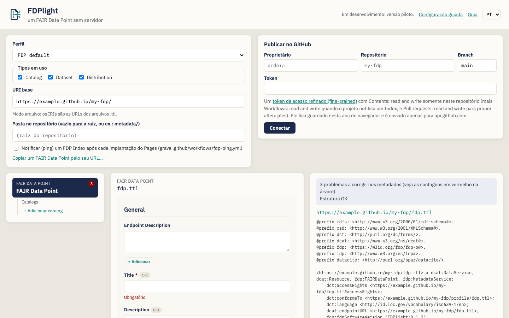
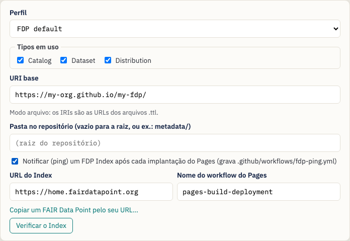
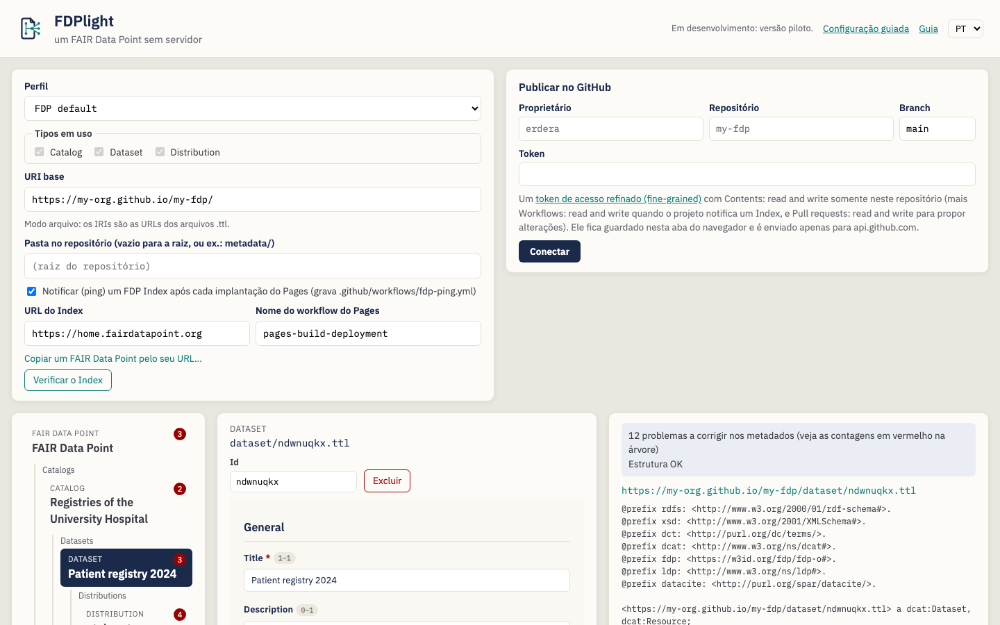
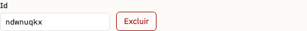
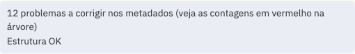
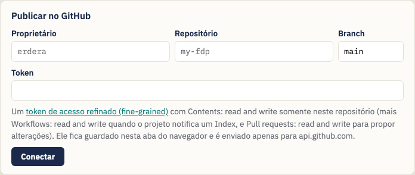
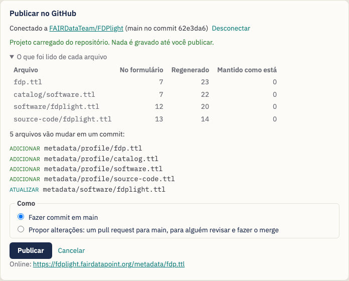
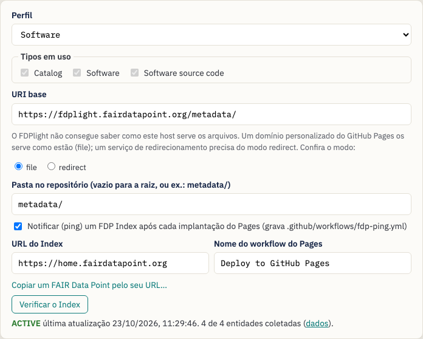
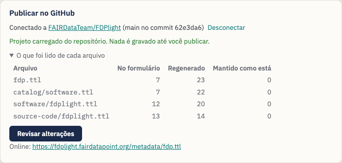

# Publicando um FAIR Data Point com o FDPlight — Um guia para data stewards

> Esta é uma tradução que ainda não foi revisada por um falante nativo. Em
> caso de dúvida, vale o guia em inglês: [English](data-steward-guide.md).

O **FDPlight** publica um [FAIR Data Point](https://www.fairdatapoint.org/)
(FDP) sem servidor. Você descreve seus catálogos, conjuntos de dados e
distribuições em formulários; o FDPlight escreve um arquivo Turtle para cada
descrição, liga esses arquivos entre si do jeito que um FDP faz e faz o commit
deles em um repositório do GitHub. O GitHub Pages serve os arquivos, e um FDP
Index pode encontrá-los e coletá-los.

> *Slogan do FDPlight: **um FAIR Data Point sem servidor.***

Este guia é para **data stewards** que querem que os metadados da sua
organização possam ser encontrados por meio de FAIR Data Point Indexes, sem
precisar rodar ou manter um servidor FDP.

> **Nada a instalar.** O FDPlight é uma página web:
> <https://fdplight.fairdatapoint.org/>. Tudo acontece no seu navegador; o
> único serviço com que ele conversa enquanto você edita é o GitHub.

---

## Sumário

1. [Conceitos básicos](#1-conceitos-básicos)
2. [Antes de começar](#2-antes-de-começar)
3. [Tutorial: publique seu primeiro FAIR Data Point](#3-tutorial-publique-seu-primeiro-fair-data-point)
   - [Passo 1 — Configurações do projeto](#passo-1--configurações-do-projeto)
   - [Passo 2 — Descreva o próprio FAIR Data Point](#passo-2--descreva-o-próprio-fair-data-point)
   - [Passo 3 — Adicione catálogos, conjuntos de dados e distribuições](#passo-3--adicione-catálogos-conjuntos-de-dados-e-distribuições)
   - [Passo 4 — Corrija o que as verificações apontam](#passo-4--corrija-o-que-as-verificações-apontam)
   - [Passo 5 — Conecte-se ao GitHub](#passo-5--conecte-se-ao-github)
   - [Passo 6 — Revise e publique](#passo-6--revise-e-publique)
   - [Passo 7 — Verifique o Index](#passo-7--verifique-o-index)
4. [Editar depois](#4-editar-depois)
5. [Importar um FAIR Data Point existente](#5-importar-um-fair-data-point-existente)
6. [Perfis: quais formulários você recebe](#6-perfis-quais-formulários-você-recebe)
7. [Dicas e solução de problemas](#7-dicas-e-solução-de-problemas)

---

## 1. Conceitos básicos

| Termo | O que significa no FDPlight |
|---|---|
| **FAIR Data Point (FDP)** | Uma árvore de registros de metadados: o próprio FDP na raiz e, abaixo dele, catálogos, conjuntos de dados, distribuições (ou outros tipos que o seu perfil defina). |
| **Entidade** | Um registro nessa árvore. Cada entidade é **um arquivo Turtle** no seu repositório, por exemplo `catalog/rare-diseases.ttl`. |
| **URI base** | Onde seus arquivos são servidos, por exemplo `https://my-org.github.io/my-fdp/`. O IRI de toda entidade começa com ele. |
| **IRI** | O identificador de uma entidade. No *modo arquivo*, o mais comum, ele é simplesmente a URL do seu arquivo, por exemplo `https://my-org.github.io/my-fdp/catalog/rare-diseases.ttl`. |
| **Perfil** | O conjunto de tipos de entidade e seus formulários (shapes SHACL). O padrão é o perfil do próprio FAIR Data Point; você também pode importar o perfil de um FDP em funcionamento ou abrir um a partir de arquivos. |
| **Ligações** | Os links de que um FDP precisa entre os registros: links entre pai e filhos, contêineres LDP, identificadores, carimbos de data/hora. O FDPlight **escreve tudo isso para você**; você só preenche os formulários. |
| **FDP Index** | Um serviço, como o [home.fairdatapoint.org](https://home.fairdatapoint.org/), que lista FDPs e coleta seus metadados. O FDPlight pode configurar um *ping* automático que mantém o seu FDP na lista. |

## 2. Antes de começar

Você vai precisar de:

- **Um repositório do GitHub** para os metadados, por exemplo `my-org/my-fdp`.
  Pode ser um repositório novo e vazio ou um que já tenha outro conteúdo:
  nesse caso, coloque o FDP em uma pasta, como `metadata/`.
- **GitHub Pages ativado** nesse repositório (*Settings → Pages*). A escolha
  mais comum é *Deploy from a branch*, branch `main`, pasta `/`. Seu URI base
  passa a ser `https://{owner}.github.io/{repository}/`, mais a pasta, se você
  usar uma. Se o site Pages tiver um domínio personalizado (por exemplo
  `https://fdp.example.org/`), use esse domínio no lugar, e escolha *file*
  quando o FDPlight perguntar como o host serve os arquivos.
- **Um token de acesso pessoal refinado (fine-grained)** somente para esse
  repositório ([crie um](https://github.com/settings/personal-access-tokens/new)):
  - *Contents: read and write* — sempre;
  - *Workflows: read and write* — se o FDPlight for notificar (ping) um FDP
    Index;
  - *Pull requests: read and write* — se você quiser propor alterações para
    revisão em vez de publicar diretamente.

  Se o repositório pertence a uma organização, talvez a organização precise
  primeiro permitir tokens refinados, e talvez um proprietário precise aprovar
  o seu.

O FDPlight guarda o token apenas na aba atual do navegador e o envia apenas
para `api.github.com`. Ao fechar a aba, ele é esquecido.

## 3. Tutorial: publique seu primeiro FAIR Data Point

Ao abrir o FDPlight, você vê no topo as configurações do projeto e o painel
de publicação e, abaixo deles, a **árvore de entidades** (à esquerda), o
**formulário** da entidade selecionada (no meio) e as **verificações e o
arquivo gerado** (à direita).

**Configuração guiada (opcional).** Na sua primeira visita, o FDPlight
oferece uma configuração guiada. Ela pergunta pelo repositório (proprietário,
nome, branch, pasta) e onde ficam os IRIs (o endereço do GitHub Pages, um
domínio personalizado ou o w3id.org), mostra o URI base que resulta disso,
deixa você escolher
um perfil e decidir se quer notificar um FDP Index, e preenche as
configurações e o formulário de conexão quando você clica em *Concluir*.
*Pular* deixa tudo como estava. Você pode abri-la de novo em *Configuração
guiada*, no cabeçalho, ou seguir os Passos 1 a 7 abaixo manualmente.

### Passo 1 — Configurações do projeto

- **Perfil** — mantenha *FDP default*, a menos que a sua comunidade use outro
  (veja a [seção 6](#6-perfis-quais-formulários-você-recebe)).
- **URI base** — onde o GitHub Pages serve os seus arquivos. O FDPlight
  sugere `https://{owner}.github.io/{repository}/` assim que você se conecta
  ao GitHub. Ele deve começar com `https://` e terminar com `/`. O FDPlight
  mostra qual *modo de IRI* usa: para endereços `github.io`, é o *modo
  arquivo*, em que cada IRI é a URL do seu arquivo `.ttl`.
- **Pasta no repositório** — deixe vazia para publicar na raiz do
  repositório, ou informe uma pasta, como `metadata/`. Nesse caso, o URI base
  precisa incluí-la.
- **Notificar (ping) um FDP Index** — marque para que o FDPlight adicione uma
  pequena GitHub Action (`.github/workflows/fdp-ping.yml`) que avisa o Index
  sobre o seu FDP após cada implantação do Pages e a cada três dias, para que
  ele continue ativo (*active*). O *Nome do workflow do Pages* é
  `pages-build-deployment` quando o Pages implanta a partir de uma branch; se
  o seu repositório tiver um workflow de implantação próprio, informe o nome
  dele.

### Passo 2 — Descreva o próprio FAIR Data Point

A raiz da árvore, *FAIR Data Point*, está selecionada. Preencha o formulário
dela: um título, um publicador, uma versão e o que mais o seu perfil pedir.
Os campos marcados com um asterisco vermelho são obrigatórios.

### Passo 3 — Adicione catálogos, conjuntos de dados e distribuições

Use os links **+ Adicionar …** na árvore. Cada nova entidade é selecionada
imediatamente para que você preencha o formulário dela; a árvore mostra o
título dela assim que houver um.

Abaixo do tipo da entidade e do nome do arquivo dela, você encontra:

- **Id** — a última parte do nome do arquivo e do IRI. O FDPlight cria um
  aleatório; você pode trocá-lo por algo legível, como
  `patient-registry-2024`, **até a entidade ser publicada**. Depois disso, o
  id faz parte de um IRI público e fica travado.
- **Mover para** — aparece quando existe outro lugar para onde a entidade
  poderia ir, por exemplo um segundo catálogo. Mover mantém o arquivo e o IRI
  da entidade, então isso também é permitido depois da publicação.
- **Excluir** — remove a entidade e tudo o que está abaixo dela.

Você pode navegar pela árvore com o teclado: **↑ ↓** para a entidade
anterior ou a próxima, **← →** para o pai ou o primeiro filho, **Home** e
**End** para a primeira e a última.

### Passo 4 — Corrija o que as verificações apontam

O FDPlight verifica cada entidade em relação ao seu perfil enquanto você
digita.

- Os **números em vermelho na árvore** contam os problemas de cada entidade.
- No formulário, cada problema aparece abaixo do seu campo (por exemplo
  *Obrigatório*).
- A caixa no canto superior direito resume: *N problemas a corrigir nos
  metadados*, e se a **estrutura** está correta (links, IRIs, o tipo da raiz).

Abaixo das verificações, você vê o **arquivo Turtle exato** que o FDPlight
vai publicar para a entidade selecionada, incluindo todas as ligações que ele
acrescenta.

Não é possível publicar enquanto houver problemas: o painel de publicação diz
o que corrigir primeiro.

### Passo 5 — Conecte-se ao GitHub

Informe o proprietário, o repositório, a branch (normalmente `main`) e o seu
token e clique em **Conectar**.

- Se o repositório já tem um projeto FDPlight, o FDPlight **carrega esse
  projeto**: configurações, perfil, árvore e metadados vêm dos arquivos. Se
  você já tinha digitado algo, ele pergunta antes de substituir.
- Se o repositório ainda não tem um FDP, nada muda, e o URI base é sugerido a
  partir do nome do repositório.

### Passo 6 — Revise e publique

Clique em **Revisar alterações**. O FDPlight lista os arquivos que vai
adicionar, atualizar ou remover e, em seguida, deixa você escolher **como**:

- **Fazer commit em `main`** — as alterações entram no ar com a próxima
  implantação do Pages, normalmente em um ou dois minutos.
- **Propor alterações** — o FDPlight coloca o mesmo commit em uma nova branch
  e abre um **pull request**, para que um colega possa revisá-lo primeiro no
  GitHub. Fazer o merge do pull request publica as alterações.

Depois de publicar, **Verificar se está online** busca o seu FDP no URI base.
Se ele ainda não estiver sendo servido, o FDPlight mostra como ativar o
GitHub Pages; a primeira implantação leva um ou dois minutos. Quando você se
conecta a um repositório que já tem um FDP, o FDPlight faz essa verificação
sozinho.

Tudo é gravado em **um único commit**. O FDPlight só atualiza um arquivo
quando o conteúdo dele muda, então a data de modificação (*modified*) de um
registro só muda quando o próprio registro (ou a sua lista de filhos) mudou.
Se outra pessoa publicou na branch desde que você se conectou, nada é
gravado: reconecte para carregar as alterações dela e depois aplique as suas
de novo.

### Passo 7 — Verifique o Index

Se o projeto notifica um Index, aparece um botão **Verificar o Index** nas
configurações. Ele mostra se o Index conhece o seu FDP, o estado dele, quando
foi a última coleta e quantas das suas entidades o Index tem.

O primeiro ping acontece depois da primeira implantação do Pages que segue a
sua publicação; a coleta leva mais alguns segundos. Um FDP que não recebe
ping durante uma semana fica inativo (*inactive*) no Index; o workflow de
ping evita isso.

### IRIs persistentes com o w3id.org (opcional)

Um URI base no GitHub Pages amarra todos os IRIs ao repositório: renomeá-lo
ou mover os arquivos mais tarde muda todos os IRIs. Com um URI base no
[w3id.org](https://w3id.org/), como `https://w3id.org/my-org/my-fdp/`, os
IRIs continuam os mesmos e o w3id os redireciona para os arquivos no GitHub
Pages (*modo redirecionamento*).

- Informe o URI base do w3id nas configurações. O FDPlight passa para o modo
  redirect e pede a **base de armazenamento**, o endereço do Pages onde estão
  os arquivos; quando você se conecta ao repositório, ele a preenche para
  você.
- Em **Regras de redirecionamento do w3id**, informe seu nome, e-mail e nome
  de usuário no GitHub (o w3id pede um responsável) e copie as regras. Faça
  um fork de [perma-id/w3id.org](https://github.com/perma-id/w3id.org), crie
  com as regras o arquivo que o FDPlight indica (por exemplo
  `ids/my-org/my-fdp/.htaccess`) e abra um pull request. As regras não mudam
  quando você adiciona registros.
- Enquanto o w3id não fizer o merge do pull request, os IRIs não funcionam.
  **Verificar o redirecionamento do w3id** diz se eles já funcionam; depois
  de publicar, o FDPlight também faz essa verificação junto com *Verificar se
  está online*.

## 4. Editar depois

Abra o FDPlight, conecte-se ao mesmo repositório, e o projeto é carregado a
partir dos arquivos. O FDPlight mostra o que leu de cada arquivo:

- **No formulário** — valores que você pode editar;
- **Regenerado** — as ligações que o FDPlight escreve de novo a cada
  publicação;
- **Mantido como está** — tudo aquilo para o qual o formulário não tem campo.
  O FDPlight nunca descarta isso: é gravado de volta sem alterações.

Edite, depois clique em **Revisar alterações** e publique como antes.
Publicar de novo sem ter editado nada não muda nada.

**Mudar o URI base depois.** Depois que o FDP foi publicado, um novo URI
base (ou uma troca entre o modo arquivo e o modo redirecionamento) muda todos os
IRIs. O FDPlight pergunta antes de fazer isso e atualiza junto as suas
próprias referências aos registros do projeto. Links de outros lugares para
os IRIs antigos deixam de funcionar, e o FDP Index passa a ver um novo FAIR
Data Point. Se você talvez mova os arquivos algum dia, escolha IRIs
persistentes com o w3id.org desde o início.

## 5. Importar um FAIR Data Point existente

O FDPlight pode assumir um FDP baseado em arquivos que não foi feito por ele,
por exemplo um escrito à mão. Conecte-se ao repositório dele; se não houver um
projeto FDPlight ali, o painel oferece a opção de **importar** um. Informe o
caminho do arquivo raiz (o arquivo que descreve o próprio FDP) e escolha:

- **Manter os IRIs existentes** (recomendado) — cada registro mantém seu
  arquivo e seu IRI, então os identificadores e a entrada no Index continuam
  válidos. Novas entidades usam o layout do FDPlight.
- **Passar para o layout do FDPlight** — os registros passam para arquivos
  como `catalog/{id}.ttl` e todos os IRIs mudam. Os arquivos antigos ficam no
  repositório até você excluí-los.

O relatório de importação lista tudo o que o FDPlight teve de corrigir ou não
conseguiu ler, por exemplo um contêiner compartilhado por dois arquivos ou um
identificador que não corresponde ao seu registro. A primeira publicação
corrige as ligações; todos os metadados são mantidos.

### Copiar um FAIR Data Point a partir do seu endereço

Se o FDP roda em outro lugar (um servidor FAIR Data Point, um endereço w3id,
um site), use **Copiar um FAIR Data Point pelo seu URL…** nas configurações
do projeto. Defina o URI base primeiro: cada registro recebe um novo IRI sob
ele e mantém um link para o seu IRI antigo (`prov:wasDerivedFrom`). O original
não é alterado. O FDPlight deixa de fora o que o servidor antigo gerou sobre
si mesmo (suas métricas, perfis e descrição da API) e escreve os seus. Revise
os formulários depois: muitas vezes faltam aos registros campos que o seu
perfil exige.

## 6. Perfis: quais formulários você recebe

A configuração **Perfil** decide quais tipos de entidade existem, como eles se
aninham e quais campos os seus formulários têm.

- **FDP default** — o perfil do próprio FAIR Data Point: FAIR Data Point →
  catálogos → conjuntos de dados → distribuições.
- **Software** — FAIR Data Point → catálogos → software → código-fonte.
- **ERDERA** — o perfil da Virtual Platform do ERDERA / EJP RD: FAIR Data
  Point → catálogos → conjuntos de dados → distribuições → serviços de acesso
  e, sob um catálogo, também registros de pacientes, biobancos, diretrizes e
  serviços de dados. Todo registro declara que está visível para a Virtual
  Platform (`ejp:vpConnection ejp:VPDiscoverable`), a menos que você escolha
  ocultá-lo. Cada serviço de dados precisa do seu *Ontological Type*: a
  Virtual Platform só lista serviços de dados que tenham um. Oculte registros
  com cuidado: com as consultas atuais da Virtual Platform, um registro oculto
  pode ocultar também outros registros, e o FDPlight mostra um aviso em um
  registro oculto.

- **Importar de um FAIR Data Point…** — informe o endereço de um FDP em
  funcionamento (por exemplo `https://home.fairdatapoint.org`); o FDPlight
  usa os tipos de entidade dele e seus shapes, para que os seus arquivos sigam
  o mesmo perfil.
- **Abrir de arquivos…** — escolha um perfil guardado no seu computador: um
  arquivo JSON com os tipos (o `fdplight.json` de outro projeto serve) e os
  arquivos de shapes em Turtle que ele indica. O FDPlight lista qualquer
  arquivo que esteja faltando ou com defeito.

**Tipos em uso.** Quando um perfil tem tipos opcionais, marque os que você
precisa em *Tipos em uso*; os outros não são oferecidos na árvore. Um tipo que
já tem registros continua marcado até você excluí-los.

Trocar o perfil inicia um projeto novo e vazio. O perfil é salvo no
repositório junto com os seus arquivos, então todos que se conectarem depois
recebem os mesmos formulários.

## 7. Dicas e solução de problemas

| Mensagem ou sintoma | O que fazer |
|---|---|
| *O GitHub rejeitou o token (401).* | O token está errado ou expirou. Crie um novo. |
| *Repositório ou branch não encontrado, ou o token não tem acesso a ele (404).* | Confira a grafia e se o token foi criado para este repositório (e aprovado, no caso de uma organização). |
| *The branch has new commits …* | Outra pessoa publicou nesse meio-tempo. Reconecte e depois faça as suas edições de novo. |
| A publicação falha em `.github/workflows/fdp-ping.yml` | Falta ao token a permissão *Workflows: read and write*. |
| *… ainda não está na web.* | Ative o GitHub Pages (*Settings → Pages → Deploy from a branch*) e veja a implantação do Pages na aba *Actions*; depois clique em *Verificar de novo*. |
| O Index não lista o FDP | Aguarde a implantação do Pages e o workflow *Ping FDP Index* na aba *Actions*; você também pode rodar esse workflow manualmente ali. |
| A interface está no idioma errado | Use o menu de idioma no canto superior direito. |
